<div align="center">
  

  <h1>MDA — Multi-so Disassembly Analyzer</h1>

  <p>
    <strong>AI-Native Multi-SO Static Analysis & Live Android Dynamic Debugging Workbench</strong><br>
    <em>Multi-SO Sessions · F5 Structured Pseudo-C · Interactive CFG · 140 MCP Tools · 24 Plugins · Android Toolbox</em>
  </p>

  <p>
    <a href="README.md">简体中文</a> &nbsp;|&nbsp; <strong>English</strong>
  </p>

  <p>
    
    
    
    
    
    
    
  </p>

  <p>
    <a href="#key-capabilities">Capabilities</a> ·
    <a href="#studio-v2-interface-gallery">Gallery</a> ·
    <a href="#installation--quick-start">Quick Start</a> ·
    <a href="#connecting-ai-mcp">Connect AI (MCP)</a> ·
    <a href="#140-mcp-tools-overview">140 MCP Tools</a> ·
    <a href="#24-pluggable-analysis-plugins">24 Plugins</a> ·
    <a href="#ai-analysis-workflows">Workflows</a> ·
    <a href="#architecture--development">Architecture</a>
  </p>

  <br>

  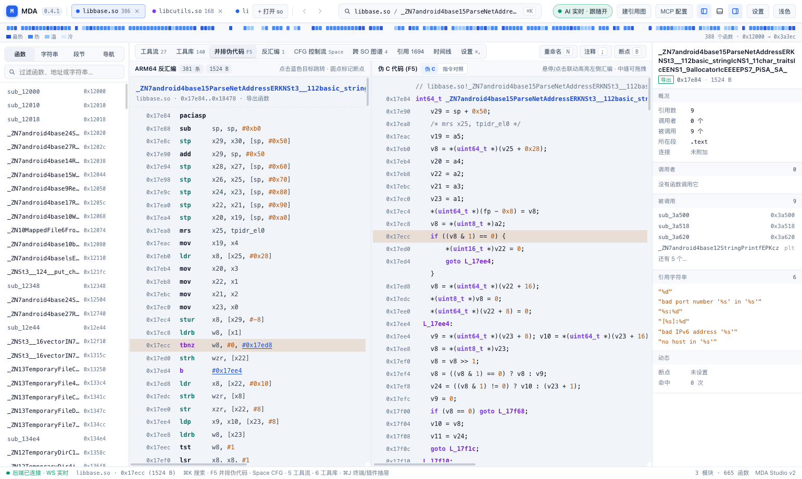
  <p><sub>MDA Studio v2 (v0.4.1): Multi-SO tabs, global reference-density heatmap, F5 side-by-side ARM64 disassembly & structured pseudo-C with synced highlighting, and Inspector</sub></p>
</div>

---

## Overview

**MDA (Multi-so Disassembly Analyzer)** is an **AI-driven reverse engineering platform** built for mobile security research and binary analysis.  
Its design philosophy is **"Static clarity, dynamic truth, one shared human–AI session"** — AI agents autonomously drive the entire pipeline from static discovery to live Android verification through **140 built-in MCP tools** and **24 analysis plugins**, while you observe every call, code jump, call graph, and device signal live inside **Studio v2**.

> **MDA vs. IDA Pro**  
> IDA excels at deep interactive single-binary manual auditing; MDA focuses on **cross-module multi-SO call resolution**, **sectionless/packed ELF resilience**, **unified Native + Java + VM live debugging**, and **letting AI agents close the reverse engineering loop end to end**.

---

## Key Capabilities

| Area | Highlights |
|---|---|
| **Multi-SO Sessions & Cross-Module Xrefs** | Load multiple ELF/SO libraries simultaneously; resolve `PLT → GOT → exported symbols` across binaries and visualize cross-SO edges as purple dashed arrows. |
| **Studio v2 Desktop Workbench** | Lightweight native **WKWebView** (no bundled Chromium) featuring **F5 side-by-side Disassembly + Structured Pseudo-C**, **Space interactive CFG**, **⌘K Command Palette**, **⌘J Plugin & Frida Drawer**, and Light/Dark themes. |
| **Packed & Sectionless ELF Friendly** | Parses `PT_LOAD` and `PT_DYNAMIC` without relying on section headers; includes 3-tier recursive function discovery (`bl_only` / `strict` / `loose`), RELA/RELR relocation & vtable resolution, JNI table discovery, and full-binary switch jump-table scanning. |
| **Static DEX / APK Analysis** | Inspect classes, method signatures, `native` flags, Dalvik bytecode disassembly, and whole-DEX `invoke-*` caller cross-references directly from `.dex`/`.apk` without unpacking to disk. |
| **Deep On-Device Dynamic Stack** | Frida 17 real breakpoints with anti-ANR `auto_resume_after_ms`, 36-register capture & runtime instruction decoding, **standalone DWARF CFI unwinding**, Linux kernel **`perf_event` hardware watchpoints**, **kernel `uprobe` allocation tracing**, anonymous memory snapshot `mem_diff`, and parameterized VM breakpoints/traces. |
| **Java Layer & Behavior Monitoring** | Auto-injects Frida 17 `java.js` bridge; supports wildcard batch `java_hook` with 3-tier hot-method auto-degradation, sibling probing on zero hits, all-thread Java stack dumps, and on-demand Crypto/File/Activity/Assets behavior monitors. |
| **Android Device Toolbox & UI Automation** | Dual-entry controls (Web UI Settings & MCP tools) for global HTTP proxy + Magisk `mitmproxy` system CA certificate management, app freeze/unfreeze (`pm suspend`), force-stop / clear-data relaunch (`pm clear`), plus non-intrusive `uiautomator` UI automation. |
| **24 Pluggable Analysis Plugins** | Integrates **angr** (isolated worker decompilation/symbolic execution), **Unicorn** (offline ARM64 function emulation + stubs), **Z3** (constraint solving), **YARA** (crypto constant detection), **LIEF** (ELF parsing), struct layout inference, string-pool decryption, OLLVM obfuscation detection, and template fuzzing. |

---

## Studio v2 Interface Gallery

### 1. F5 Side-by-Side: ARM64 Disassembly & Structured Pseudo-C (Light & Dark Themes)

- **Structured Pseudo-C Generator (`server/core/pseudocode_c.py`)**: Folds stack prologues and `adrp`/`cmp`/`bl` call arguments, infers parameters and local variables, inlines `.rodata` strings & symbols, and preserves exact source instruction addresses on every line.
- **Bidirectional Sync**: Hovering or clicking any instruction highlights the corresponding pseudo-C line (and vice versa). Drag the center splitter freely, toggle Pseudo-C / Instruction mapping, mark inline breakpoints (`B`), rename functions (`N`), and add comments (`;`).

<table>
  <tr>
    <td width="50%">
      
      <p align="center"><sub><b>Light Theme</b>: Selecting <code>0x17ecc</code> highlights both ARM64 disassembly and pseudo-C in sync</sub></p>
    </td>
    <td width="50%">
      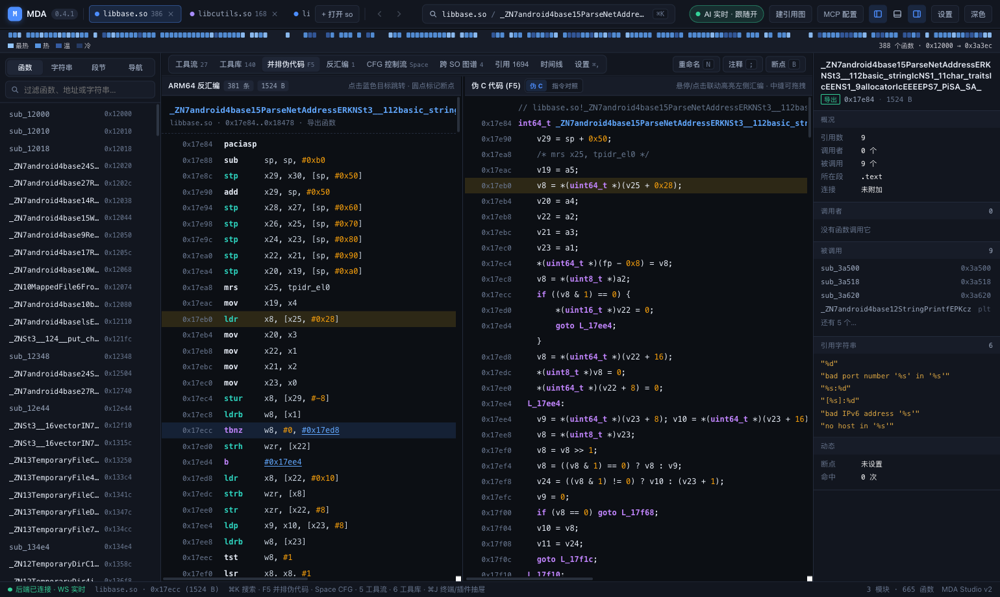
      <p align="center"><sub><b>Dark Theme</b>: Inspecting <code>libcutils.so!ashmem_create_region</code> with full syntax highlighting</sub></p>
    </td>
  </tr>
</table>

---

### 2. Cross-SO Call Graph & Interactive Basic-Block CFG (`Space`)

- **Cross-SO Graph (`4`)**: Deterministic 3-column topology (Callers / Focus / Callees). **Blue solid edges** denote intra-module calls; **purple dashed edges** highlight cross-SO calls (e.g., 18 callers in `libcutils.so` converging into `liblog.so!__android_log_print`). Click to refocus, double-click to open code.
- **Control Flow Graph (`Space`)**: Automatically splits ARM64 basic blocks with color-coded edges (**Green**: conditional True, **Red**: fallthrough False, **Blue**: unconditional jump), pan/zoom controls, and click-to-jump directly into assembly.

<table>
  <tr>
    <td width="50%">
      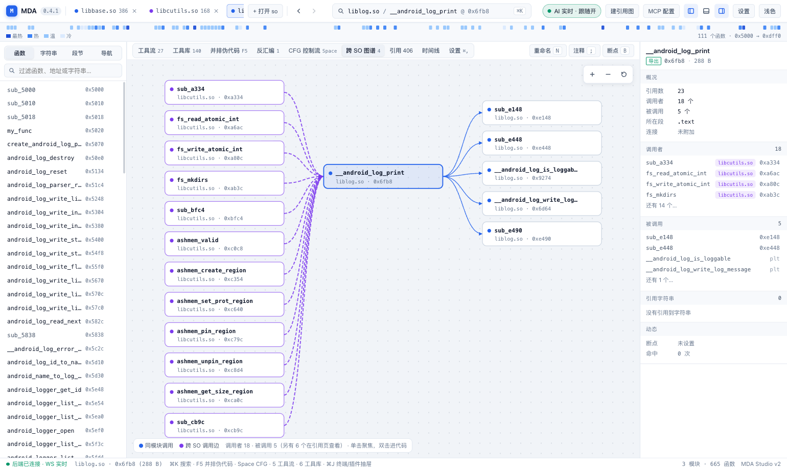
      <p align="center"><sub><b>Cross-SO Call Graph</b>: 18 cross-module callers from <code>libcutils.so</code> into <code>liblog.so!__android_log_print</code></sub></p>
    </td>
    <td width="50%">
      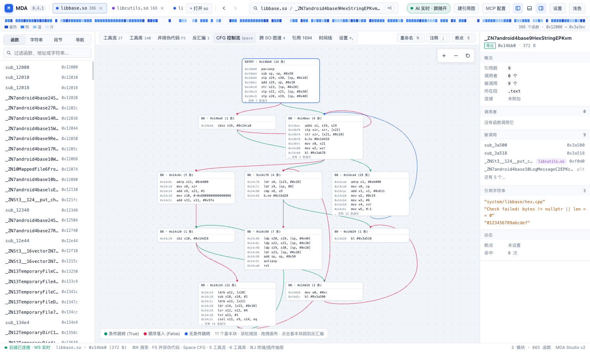
      <p align="center"><sub><b>Control Flow Graph</b>: 11 basic blocks of <code>HexString</code> with referenced strings in the right Inspector</sub></p>
    </td>
  </tr>
</table>

---

### 3. Bidirectional Cross-References & Strings / Sections Explorer

- **Xrefs View**: Dual-column Callers & Callees view with export badges and module tags for instant navigation.
- **Multi-Mode Left Sidebar**: Switch seamlessly between **Functions / Strings / Sections / 5-Group Navigation** (Static · Dynamic · VM · Behavior · Tools with live counts), paired with a persistent **Reference-Density Heatmap** across the top.

<table>
  <tr>
    <td width="50%">
      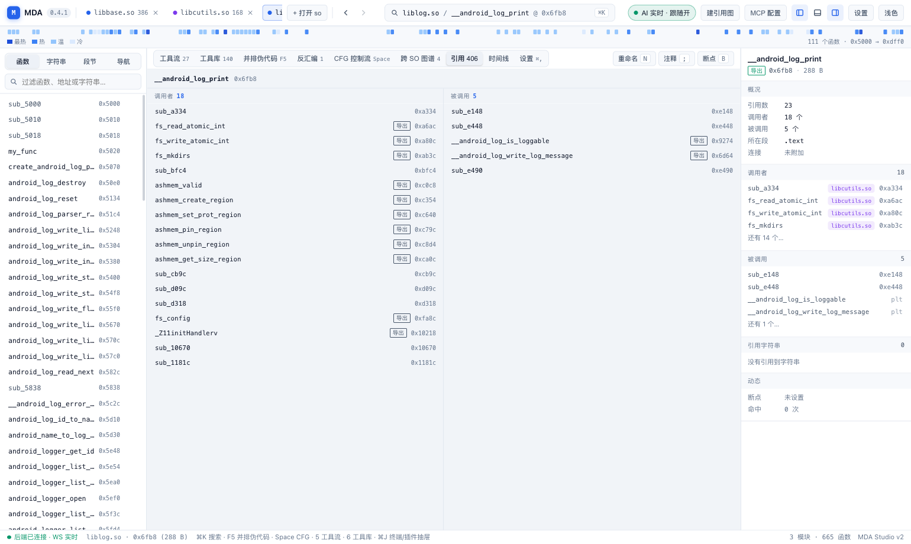
      <p align="center"><sub><b>Bidirectional Xrefs</b>: 18 callers and 5 callees side by side with export tags and addresses</sub></p>
    </td>
    <td width="50%">
      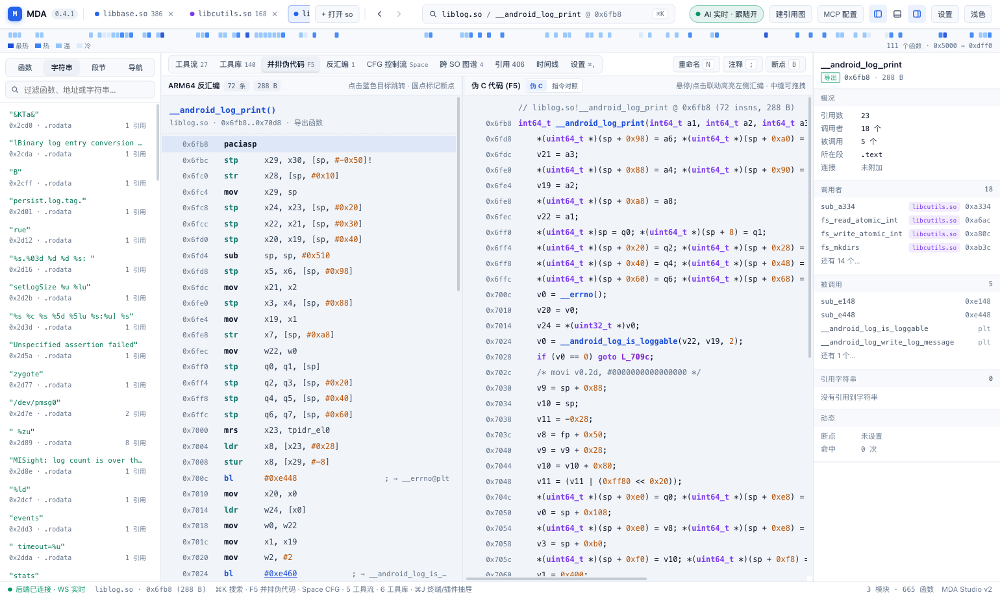
      <p align="center"><sub><b>Strings Panel + Pseudo-C</b>: Live <code>.rodata</code> string table with reference counts</sub></p>
    </td>
  </tr>
</table>

---

### 4. Real-Time AI Monitor, Signal Bus & Execution Timeline

- **AI MCP Live Monitor (`5`)**: Top instrument stage renders a 4-channel SVG signal bus visualizing live AI interactions across Process/System, Behavior Hook & UI, Native SO Memory, and Breakpoints/ARM64 Registers. Below, three synchronized panes display target device status, real-time MCP tool stream with 6 activity lanes, and full JSON request/response payloads.
- **Execution Timeline**: Displays `√`-scaled Gantt bars for every real MCP invocation, automatically pinning the slowest bottleneck to the top.

<p align="center">
  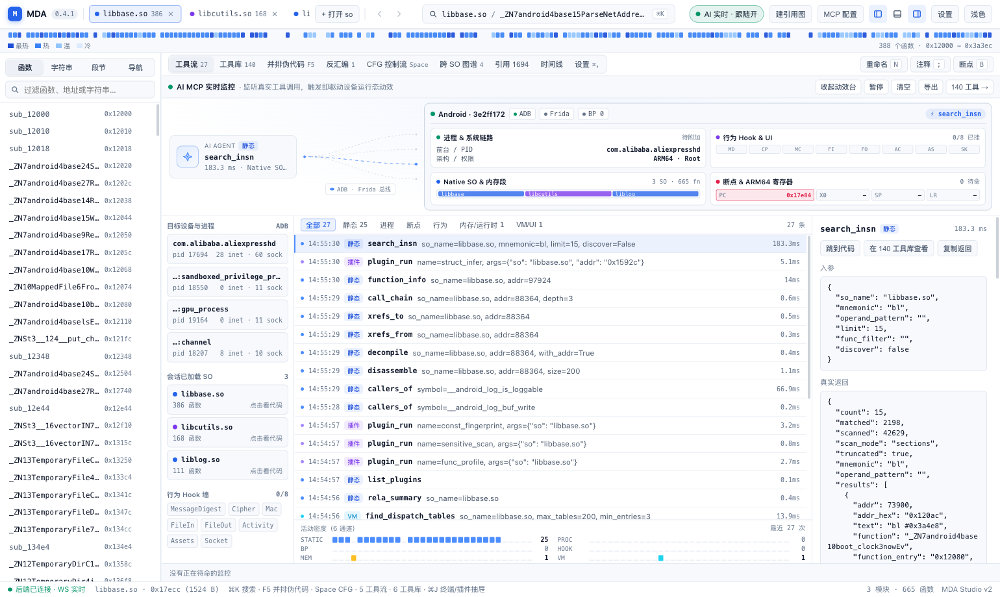
  <sub><b>Real-Time Monitor</b>: 4-channel AI ↔ Android signal bus, loaded SO list, live MCP event stream, and JSON inspector</sub>
</p>

<p align="center">
  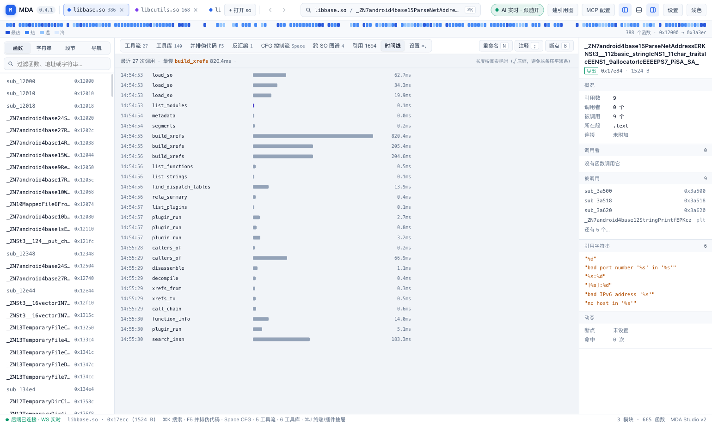
  <sub><b>Execution Timeline</b>: Real wall-clock duration Gantt bars with automatic slowest-call callout</sub>
</p>

---

### 5. 140 MCP Tools Directory · ⌘K Command Palette · ⌘J Plugin & Frida Drawer

- **Tools Directory (`6`)**: Dynamically loaded from the backend MCP registry (**140 tools** across 12 categories). Invoked tools display live call badges and pulse into view; click any entry to inspect its full description and parameter schema.
- **Resizable Bottom Drawer (`⌘J`)**: Houses **Quick Plugin Analysis** (`struct_infer`, `sensitive_scan`, `func_profile`) alongside a real **Frida Live Terminal** supporting both one-shot (`once`) and persistent (`keep`) scripts with automatic `console.log` streaming.
- **Global Command Palette (`⌘K`)**: Keyboard-first fuzzy search across every loaded function, address, 140 MCP tools, and view commands.

<p align="center">
  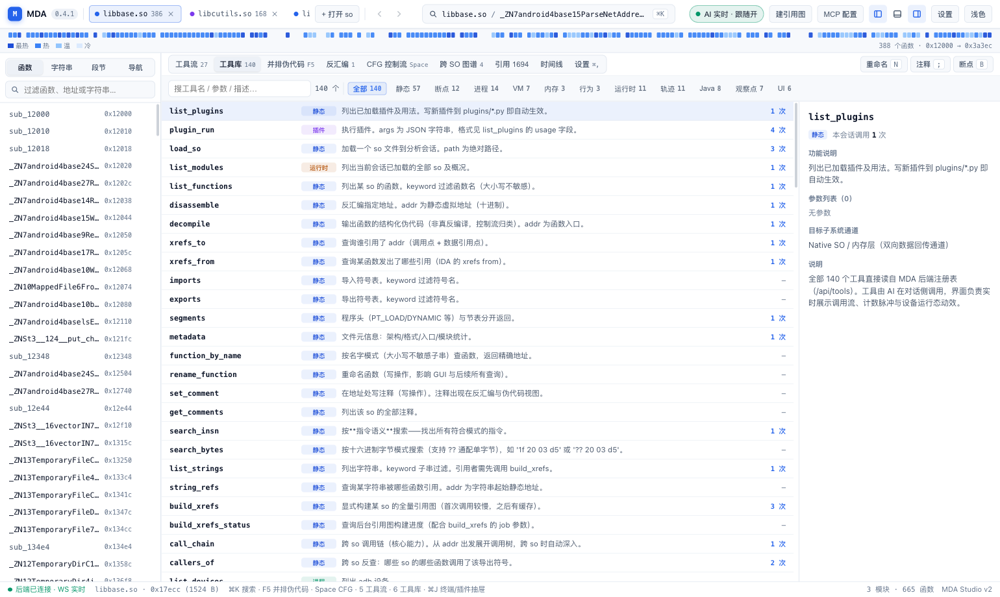
  <sub><b>140 MCP Tools Catalog</b>: Filter by category, view live invocation counts, and inspect full tool documentation</sub>
</p>

<table>
  <tr>
    <td width="50%">
      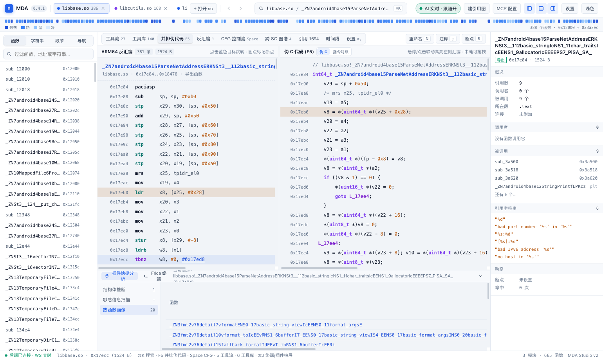
      <p align="center"><sub><b>⌘J Bottom Drawer</b>: Read F5 pseudo-C above while running quick plugin profiles or Frida scripts below</sub></p>
    </td>
    <td width="50%">
      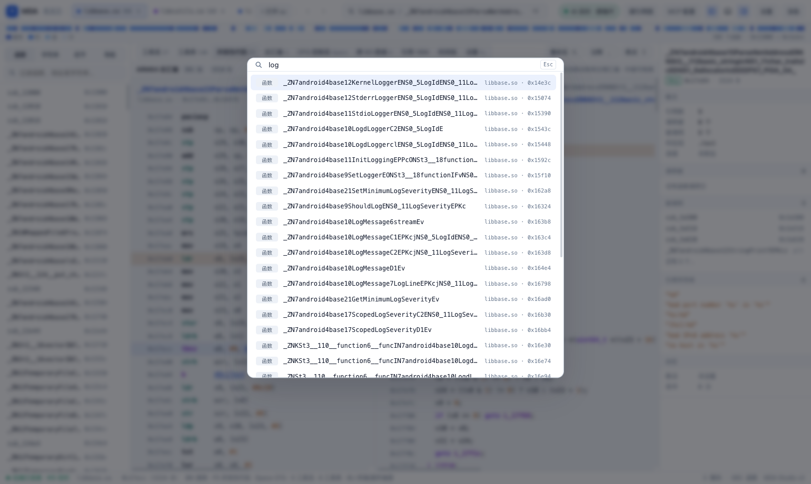
      <p align="center"><sub><b>⌘K Command Palette</b>: Instant fuzzy search across all loaded SO functions, addresses, and 140 tools</sub></p>
    </td>
  </tr>
</table>

---

### 6. Settings & Android Device Toolbox (`⌘,`)

Shares the exact same backend engine as MCP tools (`device_proxy`, `device_app_suspend`, `device_app_reset`), allowing both one-click manual operation and autonomous AI control:

- **Global HTTP Proxy & mitmproxy System CA**: Auto-detects host LAN IP and device `wlan0` IP, manages 4 Android global proxy keys simultaneously (MIUI/HyperOS compatible), and installs/removes Magisk-persisted system root certificates.
- **Favorite App Quick Actions**: Save foreground or installed apps with automatic real app-label resolution, then **Freeze (`pm suspend`) / Unfreeze / Force Stop / Clear Data & Relaunch (`pm clear`)** from a single row.

<p align="center">
  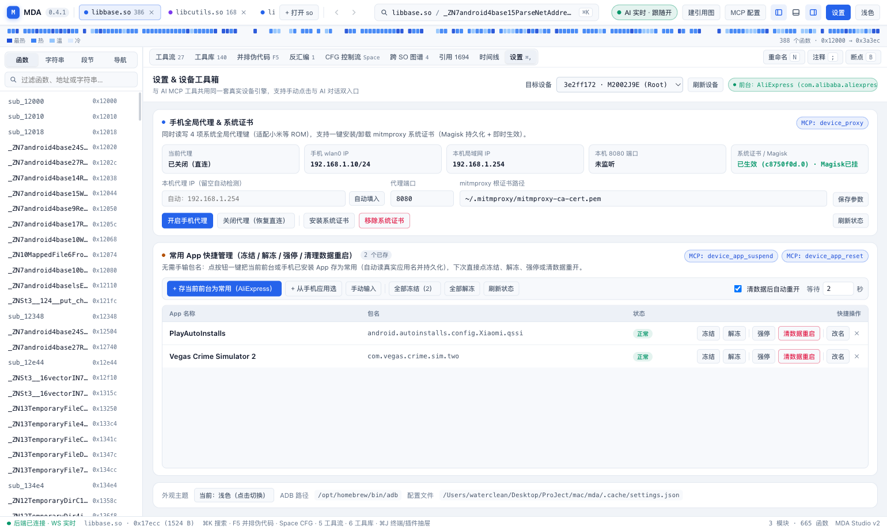
  <sub><b>Settings & Android Toolbox</b>: Global HTTP proxy, Magisk system CA management, and one-click app freeze/reset</sub>
</p>

---

### Keyboard Shortcuts

| Shortcut | Action | Shortcut | Action |
|---|---|---|---|
| `⌘K` / `Ctrl+K` | Open Global Command Palette | `F5` | Toggle Side-by-Side Pseudo-C / Full Disassembly |
| `Space` | Toggle Basic-Block CFG View | `1` / `4` | Switch to Full Disassembly / Cross-SO Graph |
| `5` / `6` | Switch to Live Tool Stream / 140 Tools Directory | `⌘,` | Toggle Settings & Android Device Toolbox |
| `⌘J` | Toggle Bottom Drawer (Plugins & Frida Terminal) | `⌘B` / `⌘I` | Toggle Left Sidebar / Right Inspector |
| `N` | Rename current function (synced with AI) | `;` | Add / edit inline comment at current address |
| `B` | Toggle breakpoint marker at current address | `Alt+←` / `Alt+→` | Navigate history back / forward |

---

## Installation & Quick Start

### Option 1: macOS Desktop App (Recommended)

Download the latest `MDA-<version>-macos-arm64.zip` from [Releases](https://github.com/xipeng5/Mda/releases):

1. Unzip and drag **`MDA.app`** into **`/Applications`**
2. Launch **MDA** from Launchpad or Applications

> **First launch warning ("unverified developer")**:  
> Right-click **MDA.app → Open**, or run:
> ```bash
> xattr -dr com.apple.quarantine /Applications/MDA.app
> ```
> Prebuilt binaries target **Apple Silicon (arm64)**. For Intel Macs or Linux, run from source below.

### Option 2: Run from Source

Requires **Python 3.11+** and **Node.js 18+** (tested on Python 3.11.15 / Node 22).

```bash
git clone https://github.com/xipeng5/Mda.git
cd Mda

python3 -m venv .venv
.venv/bin/pip install -r requirements.txt

# Build Studio v2 frontend (once, or after frontend edits)
cd web && npm install && npm run build && cd ..

# Launch desktop workbench (starts UI/API on 8766 and MCP on 8765)
.venv/bin/python app.py
```

Headless CLI static analysis is also available:

```bash
.venv/bin/python mda.py analyze libfoo.so
.venv/bin/python mda.py chain libfoo.so 0x1234
```

### Ports

| Port | Purpose | Override Env Var |
|---|---|---|
| `127.0.0.1:8766` | Studio v2 Web UI + REST API + WebSocket (`/api/events`) | `MDA_API_PORT` |
| `127.0.0.1:8765` | Built-in Streamable HTTP MCP Server (shared session) | `MDA_MCP_PORT` |

---

## Connecting AI (MCP)

Click **MCP Config** in the top-right toolbar to copy the exact ready-to-paste configuration (auto-detected for source or `.app` bundle):

```json
{
  "mcpServers": {
    "mda": {
      "url": "http://127.0.0.1:8765/mcp"
    },
    "mda-stdio": {
      "command": "/abs/path/to/Mda/.venv/bin/python",
      "args": ["/abs/path/to/Mda/app.py", "--mcp-stdio"]
    }
  }
}
```

Paste into any MCP-compatible AI client (DeepSeek Harness, Claude Desktop, Cursor, etc.) and keep either the HTTP or stdio entry:

- **Automatic Session Forwarding**: `--mcp-stdio` detects a running MDA GUI and forwards tool calls into it for real-time human–AI co-viewing, or falls back to standalone in-process mode when the GUI is closed.
- **Live Co-Viewing**: Loading a library via `load_so` immediately adds its tab and heatmap; calling `disassemble` / `decompile` / `xrefs_to` automatically navigates and highlights the target line in Studio v2.

---

## 140 MCP Tools Overview

Organized into 11 functional groups (full parameter schemas are exposed via `tools/list` and documented in [docs/manual-dynamic.md](docs/manual-dynamic.md)):

<details open>
<summary><strong>1. Module Management & ELF Overview (7)</strong></summary>

| Tools | Description |
|---|---|
| `load_so` `unload_so` `clear_modules` | Load, unload, or batch-clear modules from the analysis session |
| `list_modules` `module_memory` | Inspect loaded SO modules and estimated memory footprint |
| `metadata` | Architecture, ELF format, entry point, and module summary |
| `segments` | Separate `PT_LOAD`/`PT_DYNAMIC` program headers and section headers (**works on sectionless dumps**) |

</details>

<details open>
<summary><strong>2. Function Discovery, Disassembly, Pseudo-C, Annotations & Search (17)</strong></summary>

| Tools | Description |
|---|---|
| `discover_functions` | 3-tier recursive function recovery (`bl_only` / `strict` full prologue / `loose`) |
| `list_functions` `function_by_name` `get_function_by_address` `function_info` | Function listing (sortable by size), lookup by name/address, and composite function profile |
| `disassemble` `export_disasm` `decompile` | ARM64 disassembly, export (`asm`/`json`/`csv`), and source-anchored structured pseudo-code |
| `imports` `exports` | Filter imported and exported symbol tables |
| `list_strings` `string_refs` `read_string` | Enumerate strings, reverse-lookup referencing functions, read C strings (static or runtime) |
| `read_typed` `read_pointer` | Typed scalar/array reads and multi-level pointer dereference chains |
| `search_insn` `search_bytes` | **Semantic instruction wildcard search** (e.g. `str` + `[x*, #0x1100]`) and hex byte-pattern search |
| `rename_function` `set_comment` `get_comments` | Shared annotations synced live between AI and Studio v2 |

</details>

<details>
<summary><strong>3. Xrefs, Cross-SO Call Chains, Relocations & Vtables (9)</strong></summary>

| Tools | Description |
|---|---|
| `build_xrefs` `build_xrefs_status` | Cached/background full cross-reference graph construction with progress polling |
| `xrefs_to` `xrefs_from` | Bidirectional code call and data/string cross-reference queries |
| `call_chain` `get_callees` `callers_of` | Recursive cross-SO call trees and cross-SO exported-symbol caller lookup |
| `rela_summary` `rela_dump` `vtable_at` | Parse `.rela.dyn` / `.rela.plt` / `RELR` / `PT_DYNAMIC` relocations and resolve vtable slots |

</details>

<details>
<summary><strong>4. Packed Binary Entry & Jump-Table Recovery (4)</strong></summary>

| Tools | Description |
|---|---|
| `find_jni_registrations` | Scan `JNINativeMethod` tables with automatic RELA `fnPtr` patching to map Java names ↔ native addresses |
| `find_dispatch_tables` | Whole-binary `switch` jump-table scanner (signed offset, absolute pointer, byte-indexed) |
| `resolve_br` `read_jump_table` | Resolve `adrp/ldr/br xN` indirect branches in both **static file and live process memory modes** |

</details>

<details>
<summary><strong>5. Static DEX / APK Analysis (4)</strong></summary>

| Tools | Description |
|---|---|
| `dex_classes` | List all classes across single `.dex` or multi-`classes*.dex` `.apk` files without extracting |
| `dex_methods` | Inspect method prototypes, register counts, `is_native` and `is_abstract` flags |
| `dex_disasm` | Disassemble Dalvik bytecode with exact code-unit offsets and switch/array payloads |
| `dex_callers` | Scan all `invoke-*` instructions to find every static caller of a Java method |

</details>

<details>
<summary><strong>6. Live Android Debugging, Breakpoints & Unwinding (29)</strong></summary>

| Tools | Description |
|---|---|
| `list_devices` `preflight` | Enumerate ADB devices; check ADB, Root, Frida version alignment, and port `27042` owner |
| `start_frida` `stop_frida` `frida_server_align` | Manage port `27042` exclusively; download, verify SHA-256, back up, and align device `frida-server` |
| `list_processes` `probe_process` `list_app_processes` `probe_network_processes` | Process listing, 3-signal liveness/injectability probe, and per-process network socket detection |
| `runtime_modules` `locate_runtime_addr` | List ASLR module bases and map runtime addresses back to static functions/offsets |
| `set_breakpoint` `remove_breakpoint` `list_breakpoints` `dedupe_breakpoints` `verify_breakpoint` | True `Interceptor` breakpoints (`hold=True` + `auto_resume_after_ms`), clean detach, dedupe, and armed checks |
| `wait_hits` `poll_events` `hits` `clear_hits` `resume` `hit_analysis` | Event stream, register-filtered/grouped hit history (`filter` / `group_by`), resume, and full hit context |
| `read_process_memory` `read_runtime_memory` `read_runtime_string` `read_memory_batch` `decode_runtime_insn` | Static/runtime memory reads, batched reads, and live process ARM64 decoding (detects inline hooks/self-decryption) |
| `list_threads` `get_callstack` | Thread inspection and symbolized unwinding via `accurate` / `scan` / standalone `dwarf` CFI / `auto` fallback |
| `freeze_process` `unfreeze_process` `detach_target` | `SIGSTOP`/`SIGCONT` whole-process snapshot freezing and clean session teardown |

</details>

<details>
<summary><strong>7. Execution Traces, Hardware Watchpoints, Kernel uprobe & Memory Diff (20)</strong></summary>

| Tools | Description |
|---|---|
| `trace_app_startup` `trace_module_load` `module_load_timeline` | `spawn`-mode startup timeline capturing SO loads + exported/delayed static breakpoints from instruction zero |
| `watch_module` `probe_hits` `trace_call_tree` | Uniformly sampled module-wide execution probes, low-overhead hit+register counters, and direct caller trees |
| `trace_aggregate` `trace_timeline` `timeline` | Function-level hotspot aggregation, compressed execution runs, and unified millisecond timelines |
| `trace_read` `trace_write` `trace_code` | libc memory read/write hooks and Stalker call-level tracing |
| `perf_watch_probe` `perf_watch` `perf_watch_daemon` `perf_watch_poll` `perf_watch_list` `perf_watch_stop` | Frida-free Linux kernel **`perf_event` hardware watchpoints** capturing inline `str`/`stp` writers |
| `uprobe_probe` `trace_alloc` | Low-overhead kernel **uprobe** tracing for `malloc`/`calloc`/`realloc`/`free` with caller module offsets |
| `mem_snapshot` `mem_diff` `mem_snapshot_clear` `watch_memory` | Small-segment-first anonymous heap diffing on-device and `mprotect` pre-write capture verification |

</details>

<details>
<summary><strong>8. Stepping & Virtual Machine (VM) Analysis (9)</strong></summary>

| Tools | Description |
|---|---|
| `suggest_breakpoints` | Static breakpoint suggestions across entry, post-call, pre-ret, and string-reference sites |
| `plan_step` `execute_step` | Static step planning and temporary-breakpoint stepping (`over` / `into` / `out` / `until_mnemonic`) |
| `find_vm_dispatch_points` `vm_regs_snapshot` `vm_breakpoint` `vm_trace` | Scan VM dispatchers and trace/break on VM bytecode with fully parameterized `ctx_expr`/`ip_mode`/`opcode_expr`/`reg_base_offset` |
| `dump_vm_state` `probe_vm_from_hits` | Parameterized VM bytecode array dumper and automatic VM context pointer discovery from hit registers |

</details>

<details>
<summary><strong>9. Java Runtime Analysis & Behavior Monitoring (12)</strong></summary>

| Tools | Description |
|---|---|
| `java_bridge_status` `java_list_methods` `java_find_classes` | Local Frida 17 `java.js` verification, dynamic class inspection, and 4-axis loaded-class search (`all_loaders`) |
| `java_hook_hint` `java_count_calls` `java_hook` | Candidate ranking + network compass, ultra-light call counters, wildcard batch hooks with 3-level auto-degradation & zero-hit diagnosis |
| `java_find_callers` `java_stacktrace` `stack_all_threads` | Java caller backtrace sampling and all-thread Java stack dumps |
| `behavior_monitor_start` `behavior_monitor_poll` `behavior_monitor_stop` | Opt-in monitors for Crypto (`MessageDigest`/`Cipher`/`Mac`), File I/O, Activity lifecycle, Assets, and Shell |

</details>

<details>
<summary><strong>10. Android Device Toolbox & UI Automation (9)</strong></summary>

| Tools | Description |
|---|---|
| `device_proxy` | Inspect/toggle global HTTP proxy and install/remove Magisk `mitmproxy` system CA certificates |
| `device_app_suspend` `device_app_reset` | Freeze/unfreeze apps via `pm suspend`; force-stop, optional `pm clear`, and cold relaunch |
| `ui_dump` `ui_find` `ui_click` `ui_input` `ui_swipe` `ui_key` | Pure ADB + `uiautomator` hierarchy inspection and interaction without injecting into the target app |

</details>

<details>
<summary><strong>11. Cross-Process Injection, Plugins & Scripting (9)</strong></summary>

| Tools | Description |
|---|---|
| `list_plugins` `plugin_run` | Discover and execute all 24 pluggable analysis plugins |
| `run_script` | Run Python snippets directly against the live shared `Session` |
| `run_idc` `run_idc_file` | Transpile and run IDA IDC scripts (`MakeName`/`MakeFunction`/`MakeCode`/`set_cmt`/`Byte`/`Word`/`Dword`) |
| `inject_selftest` `inject_resolve_syscall_offset` `inject_read_memory` `inject_write_memory` | Frida-independent `ptrace` & `/proc/<pid>/mem` cross-process memory read/write and remote syscall self-test |

</details>

---

## 24 Pluggable Analysis Plugins

Drop any script into `server/plugins/*.py` for automatic discovery via `plugin_run` or the Studio v2 `⌘J` drawer:

| Category | Plugins | Capabilities |
|---|---|---|
| **Control Flow & Decompilation** | `disasm_func` `decompile_c` `call_graph` | Basic-block CFG extraction, CFG-structured pseudo-C, and call graph expansion including vtable edges |
| **Deep Analysis Engines** | `angr_bridge` `emulate_func` `solve_constraint` | Isolated-worker **angr** decompilation/symbolic analysis, offline **Unicorn** ARM64 emulation (with `unicorn_stubs`), and **Z3** constraint solving |
| **Dataflow & Structure** | `data_flow` `struct_infer` `vtable_traversal` `xref_enhanced` | Backward register dataflow slicing, `[reg+offset]` struct layout inference, vtable reference traversal, and relocation-obfuscation detection |
| **Crypto & Obfuscation** | `detect_so_crypto` `const_fingerprint` `detect_obfuscation` `string_crack` `string_ref_resolve` | **YARA** crypto constant matching, algorithm fingerprinting, 6 OLLVM/ARM64 obfuscation detectors, XOR/LCG/rolling string-pool decryption, and ciphertext xref resolution |
| **Triage & Binary Diff** | `func_profile` `sensitive_scan` `diff_so` `scan` `elf_lief` `so_fingerprint` | Whole-table function profiling, URL/IP/path/secret scanning, function-level binary diffing, batch instruction scanning, **LIEF** ELF enrichment, and local SO fingerprint database |
| **Fuzzing & Runtime Helpers** | `fuzz_combine` `patch_memory` `symbolic_boundary` | Bounded template-based signature/concatenation fuzzing engine, live process byte patching/restoration, and symbolic-execution boundary reporting |

---

## AI Analysis Workflows

### 1. Locating Entry Points in Packed / Sectionless SOs
```text
load_so → metadata → discover_functions(use_prologue=True)
→ find_jni_registrations / find_dispatch_tables / rela_summary
→ suggest_breakpoints → set_breakpoint(hold=True, auto_resume_after_ms=3000)
→ poll_events → hit_analysis → resume
```

### 2. Finding Who Wrote an Encrypted Buffer (Including Inline `str`/`stp`)
```text
mem_snapshot(key="t1") → [trigger app action] → mem_diff(key="t1", min_size=64, max_size=128)
→ perf_watch_daemon(addr="0x...", watch_type="w", slot=0)
→ perf_watch_poll(slot=0) → locate_runtime_addr → decompile
```

### 3. Slicing High-Frequency Breakpoint Hits by Register Value
```text
set_breakpoint(hold=False)
# ... interact with target app ...
hits(group_by="x2")                 # inspect distribution → {"0x1": 523, "0x4": 437, "0x5": 210}
hits(filter={"x2": 5}, limit=10)    # isolate exact command opcode
hit_analysis                        # jump straight into pseudo-C & callers
```

### 4. Discovering Active Java Signing / Networking Classes Blindly
```text
java_hook_hint(query="Sign", include_network=True, count_seconds=5)
→ java_hook(pattern="*NetworkConverter*", method="convert*", max_classes=20, sibling_probe=True)
→ java_find_callers(class_name="...", method="convertRequest")
```

---

## Dynamic Debugging Setup

1. **Device `frida-server` (Root Required)**: Run `frida_server_align` (`dry_run=True` first) to automatically download, SHA-256 verify, back up, and align device `frida-server` with your host Frida version. MDA manages port **`27042`** exclusively and leaves custom-port instances untouched.
2. **Frida 17 Java Bridge**: Frida 17 removed the built-in `Java` runtime; MDA automatically injects `frida_tools`'s `bridges/java.js` with zero manual setup (`java_bridge_status` verifies availability).
3. **IDA IDC Script Support**: Execute existing IDC annotation scripts directly via `run_idc_file(so_name=..., path=...)`.

---

## Architecture & Development

```text
app.py                         Entrypoint: Studio v2 desktop app or --mcp-stdio proxy
mda.py                         CLI entrypoint (mcp / analyze / chain)
server/
  api.py                       Starlette REST + WebSocket server (8766, local Origin/Host guard)
  web_app.py                   pywebview native window & graceful shutdown
  version.py                   Single source of truth for version (0.4.1)
  core/                        Static engine (ELF, Capstone, pseudocode_c, discover, xref,
                               rela/vtable, DWARF CFI, strings, insn_search, dex/, unicorn_stubs)
  mcp_server/                  140 MCP tools, Streamable HTTP server & stdio proxy
  dyn/                         Dynamic stack (Frida debugger, stepper, Java bridge, perfwatch,
                               uprobe, VM break/trace, behavior, UI automation, console, toolbox)
  scripting/                   Python session runner & IDC transpiler
  plugins/                     24 pluggable analysis modules (including isolated angr_worker)
web/                           Studio v2 frontend (React + TypeScript + Vite)
packaging/mda.spec             PyInstaller bundle spec (auto package scan + native data files)
tests/                         Regression, static/dynamic, DEX, RELA, console & security test suites
docs/                          Manuals, design prototypes & verification logs
```

### Frontend & Packaging

```bash
# Frontend HMR dev server (talks to backend on 8766)
cd web && npm run dev

# Production build & macOS arm64 bundle (always use .venv/bin/pyinstaller)
cd web && npm run build && cd ..
PYINSTALLER_CONFIG_DIR=$PWD/.pyinstaller .venv/bin/pyinstaller packaging/mda.spec --noconfirm --clean
cd dist && zip -qry MDA-0.4.1-macos-arm64.zip MDA.app
```

---

## Further Documentation

| Document | Topic |
|---|---|
| [docs/manual-dynamic.md](docs/manual-dynamic.md) | Live dynamic debugging, Frida 17 & Java Hook manual |
| [docs/16-MCP调用控制台.md](docs/16-MCP调用控制台.md) | Interactive Frida terminal & live script console |
| [docs/dwarf-cfi.md](docs/dwarf-cfi.md) | Standalone DWARF `.eh_frame` stack unwinding |
| [docs/uprobe-alloc-trace.md](docs/uprobe-alloc-trace.md) | Kernel `uprobe` low-overhead allocation tracing |
| [docs/vm-trace-parameterized.md](docs/vm-trace-parameterized.md) | Parameterized VM breakpoints & bytecode tracing |
| [docs/android-ui-operations.md](docs/android-ui-operations.md) | Injection-free Android UI automation guide |
| [docs/verification.md](docs/verification.md) | Core pipeline verification logs & postmortems |

---

## Notice & License

- This repository contains **no** third-party commercial `.so` binaries and **no** `frida-server` binaries.
- All static analysis screenshots are rendered live from open-source AOSP libraries (`libbase.so`, `libcutils.so`, `liblog.so`).
- Intended strictly for authorized security research, hardening verification, and educational reverse engineering.
- Licensed under the **MIT License**.
