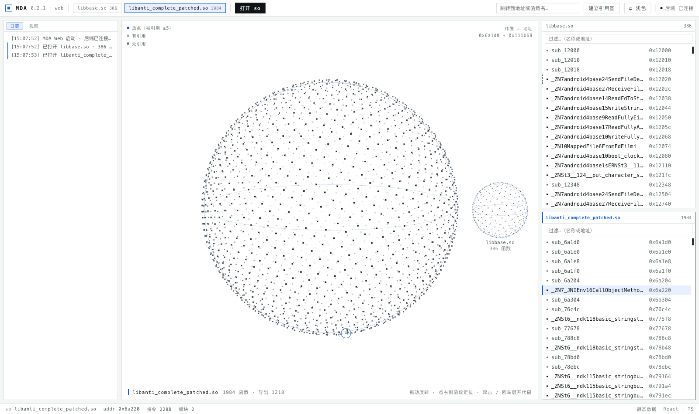
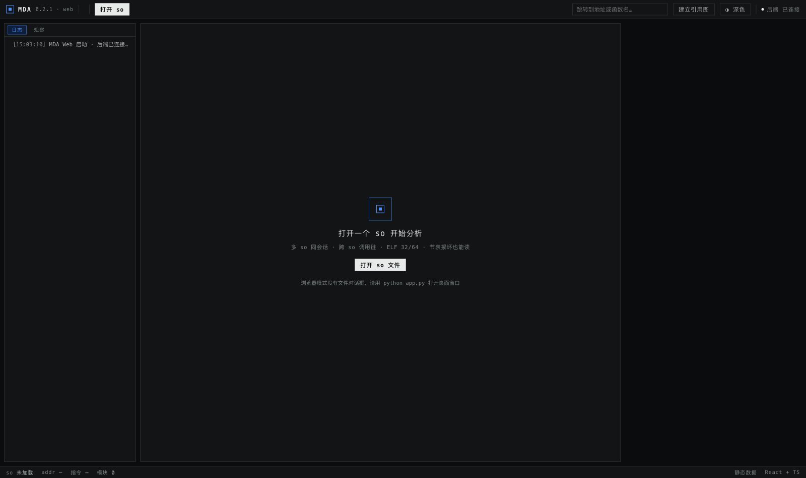
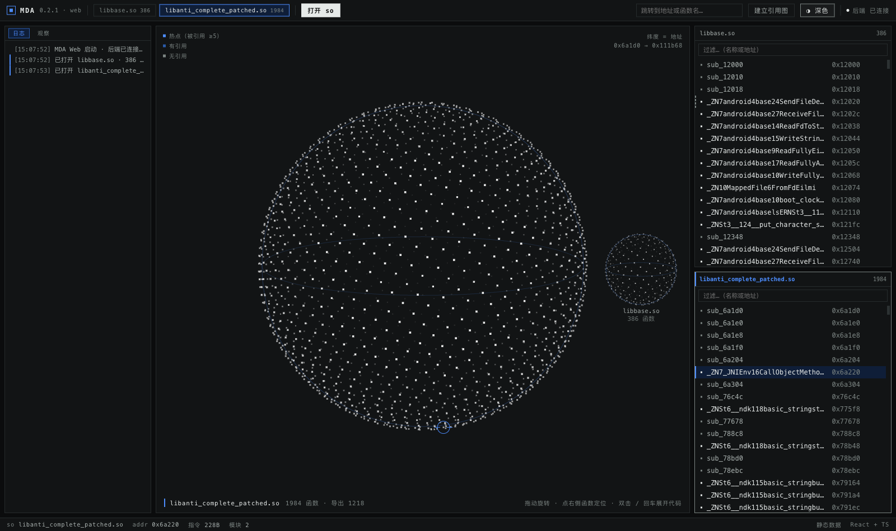
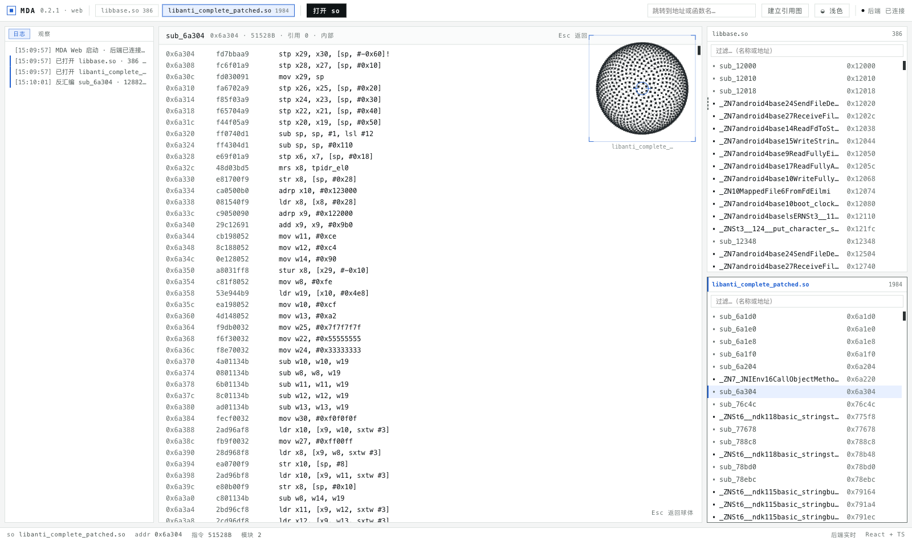
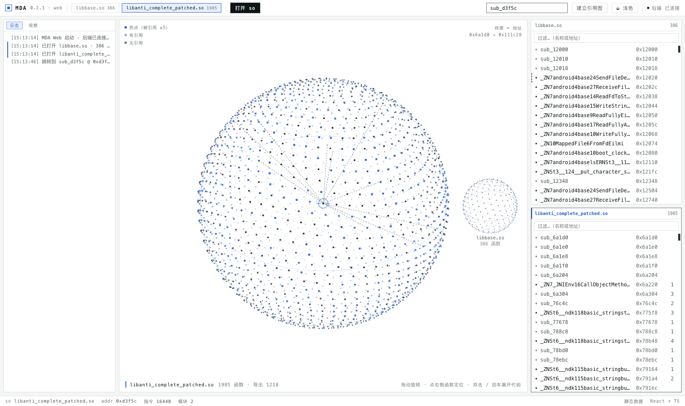

<div align="center">
  

  # MDA — Multi-so Disassembly Analyzer

  **多 so 静态分析 + 真机动态调试，内置 MCP 让 AI 直接驱动**

  多 so 同会话 · 跨 so 调用链 · 函数球可视化 · 真断点调试 · Java 层 hook
</div>

---

## 这是什么

AI 驱动的逆向分析平台。**静态看清结构，动态看真值**，两者共享同一份会话。

- **多 so 同会话**：一次加载多个 so，跨模块解析 PLT → GOT → 导出符号，还原完整调用树
- **函数球**：每个点是一个函数，纬度按地址排序，颜色按被引用次数分级——一眼看出热点
- **真机动态调试**：真断点（不是采样）、36 个寄存器、按运行时地址读内存、四种跳转表形态全库扫描
- **Java 层可见**：hook Java 方法、追调用者、通配符批量定位——从 native 跨到上层
- **内置 MCP（82 个工具）**：AI 可加载文件、反汇编、追调用链、下断点、hook Java、跑 IDC 脚本
- **人机同屏**：AI 每调一次工具，界面同步高亮对应函数、弹出操作卡、滚动日志——你能**看着 AI 干活**
- **加固样本友好**：节表被抹、导出表清空、FDE 不全、控制流平坦化都能处理

> 与 IDA 的取舍：IDA 更擅长交互式单文件深度分析；MDA 擅长**多模块调用关系**与
> **让 AI 自主完成整条分析链路**（从静态定位到真机验证，全流程不需要人点鼠标）。

## 界面

界面用 **React + TypeScript** 写，跑在本机 **WKWebView**（系统 WebView，不打包 Chromium）。



**三栏布局**

- **左**：日志（AI 的每次工具调用）/ 观察列表
- **中**：函数球——当前 so 放大居中，其余 so 缩成小球停在两侧并显示名字
- **右**：按 so 分组的函数列表，支持过滤，AI 定位时会自动滚动并高亮

**操作**

| 动作 | 效果 |
|---|---|
| 拖动球体 | 旋转，看不同纬度的函数分布 |
| 点右侧函数 | 球旋转到该点正面，状态栏显示地址/大小/引用数 |
| 双击 / 回车 | 反汇编铺满舞台，球缩成右上角方形缩略图 |
| `Esc` | 从代码返回球体 |
| 顶部跳转框 | 输入 `0x621d0` 或函数名，跨 so 定位 |
| 拖入 `.so` | 松手即加载（也可以点「打开 so」走系统文件对话框） |
| 「建立引用图」 | 真实构建引用图，完成后点云按引用热度着色、画出调用关系线 |

**主题**：默认跟随系统深浅色（`prefers-color-scheme`），点顶部按钮可手动锁定。

<p>
  
  
</p>

**代码视图**（真实 ARM64，12k+ 条指令也能秒开——虚拟滚动，DOM 里只保留可视区域）



**引用关系**（蓝点=被引用/热点，关系线=调用者与被调用者，来自真实 xref 计算）



## 安装

### 方式一：下载 macOS 客户端（推荐）

到 [Releases](https://github.com/xipeng5/Mda/releases) 下载最新的
`MDA-<版本>-macos-arm64.zip`：

1. 解压后把 **MDA** 拖进 **Applications**
2. 从启动台打开

> 首次打开若提示「无法验证开发者」（未签名应用的正常提示）：
> **右键 → 打开**，或执行 `xattr -dr com.apple.quarantine /Applications/MDA.app`
>
> 当前包是 **Apple Silicon (arm64)**；Intel 机器请用源码方式运行。

### 方式二：从源码运行

```bash
git clone https://github.com/xipeng5/Mda.git
cd Mda
python3 -m venv .venv
.venv/bin/pip install -r requirements.txt

# 前端只构建一次；改前端代码后重跑
cd web && npm install && npm run build && cd ..

.venv/bin/python app.py
```

> 需要 Python 3.11+ 与 Node 18+（开发环境 Python 3.11.15 / Node 22）。
>
> 动态调试部分还需要设备端 frida-server，见 [动态调试](#动态调试)。

## 使用

### 启动

```bash
.venv/bin/python app.py
```

会启动本地服务（`127.0.0.1:8766`，同时托管前端）并打开原生窗口；
内置 MCP 服务监听 `127.0.0.1:8765`，**AI 与界面共享同一份会话**。

启动后是空状态，打开或拖入一个 so 开始：

```bash
# 也可以从命令行直接分析（不开界面）
.venv/bin/python mda.py analyze libfoo.so
.venv/bin/python mda.py chain libfoo.so 0x1234
```

### 端口

| 端口 | 用途 |
|---|---|
| `8766` | 界面 + HTTP API（`/api/*`） |
| `8765` | MCP 服务（AI 接入），可用 `MDA_MCP_PORT` 覆盖 |

> 同机只能跑一个 GUI 实例：第二个实例的 MCP 会因端口占用而跳过（界面日志里会提示）。

## 接入 AI（MCP）

### 一键复制配置

点右上角 **「复制 MCP 配置」**，剪贴板里会得到：

```json
{
  "mcpServers": {
    "mda": { "url": "http://127.0.0.1:8765/mcp" },
    "mda-stdio": {
      "command": "/绝对路径/Mda/.venv/bin/python",
      "args": ["/绝对路径/Mda/app.py", "--mcp-stdio"]
    }
  }
}
```

粘到 AI 客户端的 `mcpServers` 里，删掉不用的那条即可。**路径与端口按当前运行形态自动生成**，
打包版会给出 `.app` 可执行文件加 `--mcp-stdio`，不用手写。

> `--mcp-stdio` 会自动探测正在运行的界面并把请求转发过去；界面没启动时退化为进程内独立分析。

### 联动效果

- AI 用 `load_so` 加载 so → 界面**自动出现**该模块
- AI 调 `disassemble` / `xrefs_to` → 球旋转定位，弹出「AI 操作」卡，日志记录耗时
- AI 加载的会话与你手动加载的是**同一份**数据

## 工具一览（82 个）

### 加载与概览

| 工具 | 说明 |
|---|---|
| `load_so` | 按路径加载 so |
| `list_modules` | 已加载的 so 及概况 |
| `metadata` | 架构 / 格式 / 入口 / 模块统计 |
| `segments` | 程序头与节表（**壳样本无节表也能出 PT_LOAD**） |

### 静态分析

| 工具 | 说明 |
|---|---|
| `list_functions` `function_by_name` | 函数表与按名查找 |
| `disassemble` `decompile` | 反汇编 / 结构化伪代码 |
| `build_xrefs` `xrefs_to` `xrefs_from` | 引用图构建与双向查询 |
| `call_chain` `callers_of` | 跨 so 调用链、跨 so 反查调用者 |
| `list_strings` `string_refs` `read_string` | 字符串与引用者 |
| `search_bytes` | 字节模式搜索（支持 `??` 通配，**壳样本可扫**） |
| `imports` `exports` | 导入 / 导出符号 |
| `read_typed` `read_pointer` | 按类型读静态数据（解跳转表、常量表） |
| `rename_function` `set_comment` `get_comments` | 标注（AI 与界面共享） |
| `run_script` | 在分析会话内跑 Python（可访问 `session`） |
| `run_idc` `run_idc_file` | IDC 脚本直译执行 |
| `list_plugins` `plugin_run` | 可插拔分析插件 |

### 找入口（壳样本关键）

| 工具 | 说明 |
|---|---|
| `find_jni_registrations` | 找 `JNINativeMethod` 数组，**一次拿到所有 JNI 入口的名字↔地址**；自带 PT_DYNAMIC 重定位解析 |
| `find_dispatch_tables` | 全库扫描 `switch` 跳转表，四种形态；不用一个地址问一次 |
| `resolve_br` | 解开单条 `br` 的跳转目标（常量 / 指针表 / 索引表） |
| `read_jump_table` | 读一张表并解析成目标地址，支持**从进程内存读**（运行时才填的表） |

### 真机动态调试

| 工具 | 说明 |
|---|---|
| `list_devices` `preflight` | 设备列表 / 环境体检（adb、root、frida 版本、端口占用） |
| `start_frida` `stop_frida` `frida_server_align` | 启停服务 / 对齐设备端与本机版本 |
| `list_processes` `probe_process` | 进程列表 / **探测死活与可注入性**（三条证据交叉验证） |
| `runtime_modules` | 运行时模块基址（ASLR 换算） |
| `set_breakpoint` `remove_breakpoint` `list_breakpoints` | 真断点（`Interceptor`，命中即挂起） |
| `wait_hits` `poll_events` `hits` `resume` | 等命中 / 事件流 / 命中历史 / 放行 |
| `verify_breakpoint` `probe_hits` | 断点是否真的 armed / 这段代码到底跑不跑（纯计数） |
| `hit_analysis` | 命中现场 → 静态上下文（前后指令 / 伪代码 / 调用者） |
| `read_process_memory` `read_runtime_memory` `read_runtime_string` | 按静态地址 / 运行时地址读内存与字符串 |
| `read_memory_batch` | 一次读多段（减少对目标的打断） |
| `decode_runtime_insn` | 从**进程内存**读指令并解码，能发现被 hook 改过的字节 |
| `locate_runtime_addr` | 运行时地址 → 静态定位（折回函数与偏移） |
| `get_callstack` `list_threads` | 线程列表 / 栈回溯并用静态模型符号化 |
| `freeze_process` `unfreeze_process` | 冻结整个进程取一致快照（**用完必须解冻**） |
| `detach_target` | 断开并清理所有 hook |

### 执行轨迹

| 工具 | 说明 |
|---|---|
| `trace_module_load` `module_load_timeline` | 模块加载时间轴 / 从已有加载事件合成时间轴并做区间异常检测 |
| `trace_app_startup` | 启动全过程（spawn 模式，从第一条指令开始） |
| `watch_module` | 在 so 的所有函数入口撒点，看**谁真的被执行了** |
| `trace_call_tree` | 指定少数入口，看**谁调用了它** |
| `trace_aggregate` `trace_timeline` | 按静态函数聚合 / 按时间顺序排列 |
| `trace_read` `trace_write` | 谁读/写了这块内存（hook libc 内存函数） |
| `trace_code` | 指令级调用 trace（**对 `system_server` 会重启系统，慎用**） |

### 单步与 VM 分析

| 工具 | 说明 |
|---|---|
| `plan_step` `execute_step` | 规划 / 真执行单步（临时断点模拟） |
| `suggest_breakpoints` | 静态给出四类候选断点位置（入口 / 调用后 / ret 前 / 数据引用） |
| `dump_vm_state` `probe_vm_from_hits` | 按 VM 上下文结构解字节码数组 / **从已有命中里挖 ctx** |

### Java 层

| 工具 | 说明 |
|---|---|
| `java_bridge_status` | 检查 Java bridge 是否可用（**纯本地**，含可选运行时规模探测） |
| `java_list_methods` | 列类的所有方法/字段，**含动态加载的类** |
| `java_find_classes` | 按类名 / 字段名 / 返回类型 / 方法名四种维度搜索 |
| `java_hook` | hook 方法，**支持通配符批量**、参数深挖、0 命中诊断 |
| `java_find_callers` | 找出**谁调用**了某个方法，返回调用栈样本 |

> 完整参数与真实示例见 [docs/manual-dynamic.md](docs/manual-dynamic.md)；
> MCP 工具的实际 schema 以 `tools/list` 为准。

## 典型的 AI 分析链路

### 场景一：壳样本找入口

```
load_so                       加载目标 so
metadata                      看架构、有没有节表
find_jni_registrations        找 JNI 注册表（拿名字↔地址）
find_dispatch_tables          全库找跳转表（VM 分发器线索）
suggest_breakpoints           对可疑函数给出候选断点
set_breakpoint                下断点（hold=true）
poll_events → hit_analysis    看命中的上下文
resume                        放行
```

### 场景二：验证某段代码到底跑不跑

```
probe_process                 先确认进程还活着、能不能注入
probe_hits                    纯计数：这个地址被执行了多少次
watch_module                  这个 so 里哪些函数被真的执行了
```

> 这三步的顺序很重要。**0 命中要先排除「进程没了」，再判断「代码没跑」**——
> 两者的表现完全一样，但结论相反。

### 场景三：2000 条命中里定位特定命令号

```
set_breakpoint(hold=false)    不挂起，只记录
# ... 期间操作 App ...
hits(group_by="x2")           先看值分布 → {"0x1": 523, "0x4": 437, "0x5": 210}
hits(filter={"x2": 5})        再精准筛出命令号 5 的那批
hit_analysis                  看现场
```

### 场景四：不知道 hook 哪个 Java 类

```
java_find_classes(pattern="*NetworkConverter*")
java_hook(pattern="*NetworkConverter*", method="convert*", max_classes=20,
          sibling_probe=True)
# → 一次 hook 所有匹配的类，分别统计命中数，直接告诉你哪个在用
java_find_callers(class_name="...", method="convertRequest")
# → 谁调了它，把整条链路串起来
```

## IDC 脚本支持

直接跑现成的 IDA IDC 脚本（翻译成 Python 执行）：

```bash
run_idc_file  so_name=libfoo.so  path=/path/to/script.idc
```

已覆盖真实脚本里高频的 API：`MakeName` `MakeFunction` `MakeCode` `set_cmt`
`is_code` `get_flags` `del_items` `Message` `Byte/Word/Dword`，
支持 `if / else if / while / BADADDR` 等语法。

## 动态调试

动态能力**只在 MCP 侧提供**，界面不暴露按钮——原因很直接：断点是「停下 → 看寄存器 →
放行」的交互，而且一旦挂起，没人处理会把目标 App 拖到 ANR。所以：

- **AI 操作**：`list_devices` → `list_processes` → `start_frida` → `set_breakpoint` → `poll_events` → `resume`
- **界面负责展示**：AI 的每次调用都进日志，命中地址会自动跳到对应函数
- 断点状态由后端单例持有，`set_breakpoint` 跨调用存活，`list_breakpoints` 可随时查

### 准备 frida-server

设备需要 root，并自行 push frida-server（仓库不含二进制）：

```bash
adb push frida-server-<版本>-android-arm64 /data/local/tmp/frida-server
adb shell "chmod 755 /data/local/tmp/frida-server"
```

> **版本必须匹配**：客户端 `frida` 与设备端 `frida-server` 大版本要一致，
> 否则会报 `ProtocolError: unable to communicate with remote frida-server`。
> 版本不一致时用 `frida_server_align`（先 `dry_run` 看计划，确认后再执行）。
>
> 设备上可能同时存在别的项目的 frida 实例——MDA 只操作监听 **27042** 的那一个，
> 不会碰其他端口。

### Java hook 的前提

frida 17 起 Java bridge **不再内置**在 server 里，脚本里直接 `Java.use(...)` 会报
`ReferenceError: 'Java' is not defined`。这是上游的架构调整，不是环境坏了。

MDA 会自动注入 `frida_tools` 自带的 `bridges/java.js`，**不需要额外安装**。
先用 `java_bridge_status` 确认可用即可。

## 架构

```
web/          React + TypeScript 前端（Vite 构建，产物被后端托管）
server/       Starlette 传输层：静态托管 + REST + WebSocket（8766）
core/         ELF 解析、反汇编、引用图、函数发现、字符串、伪代码
mcp_server/   MCP 工具层（82 个工具）、HTTP 服务、stdio→进程内代理
dyn/          动态能力
              ├─ adb.py        设备与 frida-server 管理、进程活性探测
              ├─ service.py    动态会话注册表、断点、事件流
              ├─ debugger.py   断点实现（Interceptor）、命中现场
              ├─ rebase.py     ASLR 换算、模块表
              ├─ tracer.py     trace / watch / probe / 调用树
              ├─ bridge.py     resolve_br / read_jump_table / 命中上下文
              ├─ memread.py    VM 状态、内存批量读、指令解码
              ├─ stepper.py    单步规划与执行
              ├─ java_bridge.py Java bridge 注入、hook、类搜索、调用者
              ├─ jni.py        JNI 注册表扫描
              ├─ dispatch.py   跳转表全库扫描
              └─ frida_server.py 服务端版本对齐
scripting/    Python 脚本执行器、IDC 直译器
plugins/      可插拔分析插件（敏感字符串扫描、函数画像）
tests/        回归与冒烟测试
```

**数据流**：界面 → `server/api.py` → `core.Session`（与 MCP 共用同一实例）→ 返回 JSON；
AI → MCP 工具 → 同一个 `Session` → 通过 `on_activity` / `on_ui_sync` 推事件到
`/api/events`（WebSocket）→ 界面同步表现。

### HTTP API

| 接口 | 说明 |
|---|---|
| `GET /api/health` `GET /api/modules` | 服务状态、已加载的 so |
| `POST /api/load` `POST /api/load_upload` | 按路径 / 按上传字节加载 |
| `GET /api/functions` `GET /api/disasm` | 函数表（含引用数）、反汇编 |
| `GET /api/xrefs` `GET /api/strings` `POST /api/xrefs/build` | 引用、字符串、构建引用图 |
| `GET /api/mcp-config` | 生成给 AI 用的 MCP 配置 |
| `WS /api/events` | AI 活动、UI 回放、引用图进度 |

## 打包

```bash
.venv/bin/pip install pyinstaller
PYINSTALLER_CONFIG_DIR=$PWD/.pyinstaller .venv/bin/pyinstaller packaging/mda.spec --noconfirm --clean
open dist/MDA.app
```

### 打包后必须自检

**只用 `.venv/bin/pyinstaller` 打包**。用错 Python 就会出现「打包成功、运行时缺模块」——
因为 PyInstaller 只收集**打包所用解释器**能 import 到的依赖。

真正的判据是日志里这一行：

```
Python environment: /Users/<you>/.../mda/.venv
```

**自检命令**（不打开 GUI，直接问打包版它自己加载了什么）：

```bash
# 注意一定要加 sleep：stdio 模式下 stdin 一 EOF 进程就退出，长调用来不及回
( printf '%s\n' \
'{"jsonrpc":"2.0","id":1,"method":"initialize","params":{"protocolVersion":"2024-11-05","capabilities":{},"clientInfo":{"name":"t","version":"1"}}}' \
'{"jsonrpc":"2.0","method":"notifications/initialized"}' \
'{"jsonrpc":"2.0","id":2,"method":"tools/call","params":{"name":"run_script","arguments":{"code":"import sys,importlib.util; m=importlib.util.find_spec(\"elftools\"); result={\"python\":sys.version.split()[0],\"frozen\":getattr(sys,\"frozen\",False),\"elftools\":(m.origin if m else \"MISSING\")}"}}}' ; sleep 6 ) \
| ./dist/MDA.app/Contents/MacOS/MDA --mcp-stdio 2>/dev/null | grep '"id":2'
```

期望看到（`python` 是 3.11.x、`frozen` 为 true、`elftools` 指向 app 包内）：

```json
{"python":"3.11.15","frozen":true,"elftools":".../MDA.app/Contents/Frameworks/elftools/__init__.py"}
```

看到 `"elftools":"MISSING"` 就说明打错了 Python，必须用 `.venv/bin/pyinstaller` 重打。

### 验证流程（顺序不能换）

```bash
# 1. 打包
PYINSTALLER_CONFIG_DIR=$PWD/.pyinstaller .venv/bin/pyinstaller packaging/mda.spec --noconfirm --clean

# 2. 杀干净所有旧进程 —— 否则 proxy 会把请求转发给旧 GUI，你测的是旧版本
pkill -9 -f "MDA.app/Contents/MacOS/MDA"

# 3. 验证 dist（此时没有实例在跑，测的才是新包）
./dist/MDA.app/Contents/MacOS/MDA --mcp-stdio   # 按上面自检命令喂 JSON

# 4. 备份并替换
rm -rf /tmp/MDA-<旧版本>-backup.app && cp -R /Applications/MDA.app /tmp/MDA-<旧版本>-backup.app
rm -rf /Applications/MDA.app && cp -R dist/MDA.app /Applications/MDA.app

# 5. 启动并确认版本（走 proxy 才反映真实运行态）
open -a /Applications/MDA.app

# 6. 压缩分发
cd dist && zip -qry MDA-<版本>-macos-arm64.zip MDA.app
```

> 第 2 步是踩坑后加的：**不杀进程会测到旧实例**，看起来像"改动没生效"。
> 第 3 步和第 5 步都要验版本 —— 前者验包，后者验运行态。

产物 `dist/MDA.app`（约 175MB）；分发包建议压成 zip（约 80MB）：

```bash
cd dist && zip -qry MDA-<版本>-macos-arm64.zip MDA.app
```

### 打包依赖的三个坑（已在 spec 里处理）

| 坑 | 现象 | 处理 |
|---|---|---|
| `collect_submodules("mcp")` 会 import `mcp.cli` | 依赖 typer 且 import 期 `sys.exit(1)` | 用 `filter=` 排除 |
| `collect_submodules` 漏模块 | 源码正常、打包版报 `MODULE_UNAVAILABLE` | **改成扫目录**（`_scan_pkg_modules`），新增文件不用改 spec |
| `frida_tools` 的 `bridges/*.js` 是数据文件 | 打包版报 `NO_FRIDA_TOOLS` | `collect_data_files` 收 js（光加 hiddenimports 拿不到） |

> 第二条踩了三次（`mcp_server.link`、`dyn.tracer` 三件套、`dyn.java_bridge` 三件套），
> 说明"靠人记着改 spec"不可靠，才改成目录扫描。

## 开发

```bash
# 前端热更新（改完仍由后端 8766 提供真实接口）
cd web && npm run dev        # http://localhost:5173

# 类型检查 + 生产构建
cd web && npm run build
```

前端源码结构：

```
web/src/App.tsx                       布局、状态、AI 事件接线
web/src/components/SphereCanvas.tsx   球体画布（拖拽/旋转/选中）
web/src/lib/sphere.ts                 球面投影、分桶绘制、关系线、进度环
web/src/components/CodeOverlay.tsx    代码视图（虚拟滚动）
web/src/components/LeftPanel.tsx      日志 / 观察
web/src/components/RightPanel.tsx     函数列表（虚拟滚动）
```

## 测试

```bash
# 四个测试集（不需要设备）
.venv/bin/python tests/test_e2e.py
.venv/bin/python tests/test_shell_sample.py
.venv/bin/python tests/test_dyn_runtime.py
.venv/bin/python tests/test_regressions.py

# 静态链路冒烟（随机端口，真 so）
.venv/bin/python tests/ui_review/smoke_web_api.py

# MCP 联动探针（需要界面在跑）
MDA_MCP_PORT=8765 .venv/bin/python tests/ui_review/mcp_probe.py
```

> 前四个不连设备，是提交前必跑的基线。`test_regressions.py` 用「R编号」锁定
> 每一个修过的 bug，改动相关代码后它应该永远绿。
>
> 测试需要样本 so。仓库**不收录他人二进制**，请自备 AOSP 的
> `liblog.so` / `libbase.so` / `libcutils.so` 放入 `samples/`。

## 文档

| 文档 | 内容 |
|---|---|
| [docs/manual-dynamic.md](docs/manual-dynamic.md) | 动态调试与 Java hook 使用手册（参数、示例、坑） |
| [docs/verification.md](docs/verification.md) | 核心链路验证记录与 bug 复盘 |
| [docs/dynamic-debug-progress.md](docs/dynamic-debug-progress.md) | 动态能力开发全程记录（决策依据与实测数据） |

## 说明

- 仓库**不含**任何第三方 App 的 so 样本，也不含 frida-server 二进制。
- 文档中的设备序列号、目标 App 名均已脱敏为占位符。
- Qt 界面已移除，当前只有 Web 界面（`ui/` 目录不再存在）。

## 许可

MIT
