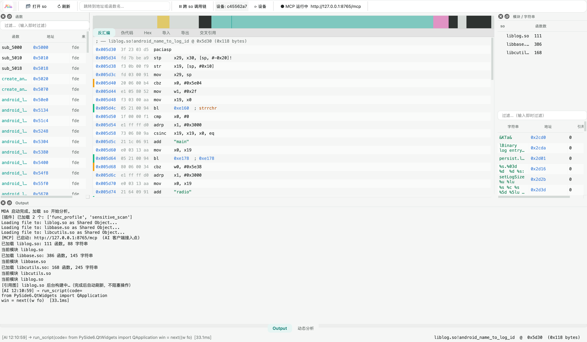
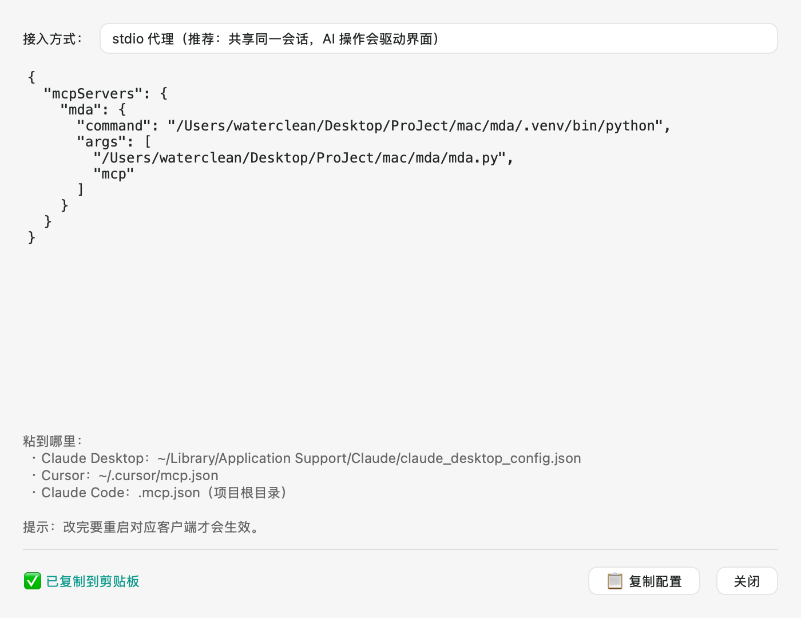

<div align="center">
  

  # MDA — Multi-so Disassembly Analyzer

  **轻量级多 so 静态 / 动态分析器 · 内置 MCP 供 AI 直接驱动**

  跨 so 调用链 · 字符串引用还原 · ELF 段表兜底 · adb/frida 动态断点 · 人机同会话
</div>

---

## 这是什么

IDA 无法直接分析**多个 so 之间的调用链路**。MDA 为此而生：

- **多 so 同会话**：一次加载多个 so，跨模块解析 PLT → GOT → 导出符号，还原完整的跨 so 调用树
- **内置 MCP**：程序启动即开 MCP 服务，AI（Claude / DeepSeek / Cursor…）可直接加载文件、反汇编、追调用链、跑 IDC 脚本
- **AI 操作可视化**：AI 每调一次工具，GUI 同步跳转 / 过滤 / 定位 —— 你能**看着 AI 干活**
- **动态分析**：adb 连接设备，frida 在 so 内部下断点、读进程内存
- **加固样本友好**：节表被抹、FDE 不全、控制流平坦化都能处理

## 界面



左上工具栏是 logo；中间是 IDA View-A 风格的反汇编（带 XREF 注释与分支连线导航条），
底部 Output 面板实时滚动 AI 的工具调用日志。

## 界面

界面用 React + TypeScript 写，跑在本机 WKWebView 里：多 so 函数球（每点=一个函数）、
调用关系线、断点标记、引用图构建进度环、透明操作卡、代码浮出层，深浅双主题。

```bash
# 1. 构建前端（只需一次，改前端代码后重跑）
cd web && npm install && npm run build && cd ..

# 2. 启动（服务 + 原生窗口；未装 pywebview 时自动开浏览器）
.venv/bin/python app.py
```

Web 版复用同一套分析内核（`core.Session`），不经过 MCP 协议层：
`server/api.py` 提供 `/api/modules`、`/api/functions`、`/api/disasm`、
`/api/xrefs`、`/api/strings`、`/api/xrefs/build` 与 `/api/events`（WebSocket）。

冒烟测试：

```bash
.venv/bin/python tests/ui_review/smoke_web_api.py
```

## 核心能力

| 能力 | 说明 |
|---|---|
| 函数发现 | `.eh_frame` FDE + `PT_GNU_EH_FRAME` 二分表 + **递归 bl 目标发现**（补 FDE 漏掉的入口） |
| 段表兜底 | 节表损坏/被抹时改用 `PT_LOAD` 直读，dump 出来的裸内存镜像也能分析 |
| 跨数据块反汇编 | 遇内联跳转表不终止，按指令宽度跳过数据继续（控制流平坦化样本必需） |
| 引用图 | `calls_to` / `called_by` / `data_refs` 三向索引，惰性构建 + 缓存 |
| IDC 脚本 | 直译执行用户现成的 `.idc`（MakeName / MakeFunction / MakeCode / set_cmt …） |
| 动态分析 | adb 设备管理、frida 断点、按 so 静态地址读进程内存（自动 ASLR 换算） |

## 安装

### 方式一：下载 macOS 客户端（推荐）

到 [Releases](https://github.com/xipeng5/Mda/releases) 下载最新的
`MDA-<版本>-macos-arm64.dmg`：

1. 双击打开 `.dmg`
2. 把 **MDA** 拖进 **Applications**（窗口里已经放好快捷方式）
3. 从启动台打开

> 首次打开若提示「无法验证开发者」（未签名应用的正常提示）：
> **右键 → 打开**，或执行 `xattr -dr com.apple.quarantine /Applications/MDA.app`
>
> 当前安装包是 **Apple Silicon (arm64)** 版本；Intel 机器请用下面的源码方式运行。

### 方式二：从源码运行

```bash
git clone https://github.com/xipeng5/Mda.git
cd Mda
python3 -m venv .venv
.venv/bin/pip install -r requirements.txt
.venv/bin/python app.py
```

> 需要 Python 3.11+（开发环境 3.11.15 / macOS arm64）。
> 动态分析功能还需在设备上放 frida-server（见下方「动态分析」）。

## 使用

### 启动界面

```bash
.venv/bin/python app.py
```

界面会启动本地分析服务（`127.0.0.1:8766`）并打开窗口；
内置 MCP 仍监听 `127.0.0.1:8765`，AI 与界面共享同一会话。

启动后 MCP 服务**自动监听** `http://127.0.0.1:8765/mcp`，状态显示在工具栏。

### 命令行

```bash
.venv/bin/python mda.py analyze libfoo.so          # 打印概况（函数/导出/调用边/字符串）
.venv/bin/python mda.py chain libfoo.so 0x1234     # 打印跨 so 调用链
.venv/bin/python mda.py mcp                        # 以 stdio 启动 MCP（AI 客户端用）
```

## 接入 AI（MCP）

MDA 提供两种接入方式，**推荐第一种**：

### 0. 一键复制配置（最省事）

启动 MDA 后点工具栏的 **`📋 MCP 配置`** → 选接入方式 → 点 **`复制配置`** →
粘到你的 AI 客户端配置文件里即可。

配置里的 Python 与脚本路径**按当前运行形态自动生成**（源码版给 venv+`mda.py`，
打包版给 `.app` 可执行文件 + `--mcp-stdio`），不用手写绝对路径。



### 1. stdio 代理（推荐）

AI 客户端配置：

```json
{
  "mcpServers": {
    "mda": {
      "command": "/绝对路径/Mda/.venv/bin/python",
      "args": ["/绝对路径/Mda/mda.py", "mcp"]
    }
  }
}
```

`mda.py mcp` 会**自动探测正在运行的 GUI** 并把请求转发过去，因此：

- AI 的操作发生在**同一个会话**（你加载的 so，AI 直接能看到）
- AI 的每次调用都会**驱动界面**（跳转、过滤、切标签页）
- GUI 没启动时自动降级为本进程内独立分析，并在 stderr 提示

> 打包版同样支持 stdio：配置里写 `MDA.app/Contents/MacOS/MDA`，参数 `["--mcp-stdio"]`。

### 2. 直接连 HTTP

```json
{
  "mcpServers": {
    "mda": { "url": "http://127.0.0.1:8765/mcp" }
  }
}
```

### 主要工具（32 个）

| 类别 | 工具 |
|---|---|
| 加载/概览 | `load_so` `list_modules` `metadata` `segments` |
| 函数 | `list_functions` `function_by_name` `rename_function` `disassemble` `decompile` |
| 引用 | `build_xrefs` `xrefs_to` `xrefs_from` `call_chain` `callers_of` `string_refs` |
| 数据 | `list_strings` `search_bytes` `imports` `exports` `set_comment` `get_comments` |
| 脚本 | `run_script`（Python）`run_idc` / `run_idc_file`（IDC 直译） |
| 插件 | `list_plugins` `plugin_run` |
| 动态 | `list_devices` `list_processes` `runtime_modules` `read_process_memory` `set_breakpoint` |

> `run_script` 里可用 `session` 对象。**性能约定**：查单个函数用
> `session.ensure_function(so, addr)`（毫秒级）；只有确实需要全库引用时才调
> `session.ensure_xrefs(so)`（6000+ 函数的样本约 10-20 秒，结果有缓存）。

## IDC 脚本支持

直接跑你现成的 IDA IDC 脚本（会翻译成 Python 执行）：

```bash
# 通过 MCP
run_idc_file  so_name=libfoo.so  path=/path/to/script.idc
```

已覆盖真实脚本里高频的 API：`MakeName` `MakeFunction` `MakeCode` `set_cmt`
`is_code` `get_flags` `del_items` `Message` `Byte/Word/Dword`，
支持 `if / else if / while / BADADDR` 等语法。

## 动态分析

```bash
# 1. 设备需 root，自行下载 frida-server（本仓库不含二进制）
#    https://github.com/frida/frida/releases
adb push frida-server-<版本>-android-arm64 /data/local/tmp/frida-server
adb shell "chmod 755 /data/local/tmp/frida-server"
```

然后在 GUI 的「动态分析」面板或经 MCP 使用：列设备 → 选进程 → 载入模块 →
在 so 的静态地址下断点（自动换算 ASLR）→ 读内存 / 看命中。

## 打包

```bash
.venv/bin/pip install pyinstaller
.venv/bin/pyinstaller packaging/mda.spec --noconfirm
open dist/MDA.app
```

产物在 `dist/MDA.app`。图标取自 `assets/icon.icns`（由 `assets/logo.png` 生成），
版本号取自根目录 `version.py`（唯一来源，窗口标题 / MCP serverInfo / Info.plist 都用它）。

### 做成 dmg 安装包

```bash
# 1) 暂存目录：放 app + 指向 /Applications 的快捷方式（拖拽安装用）
rm -rf dist/dmg_root && mkdir -p dist/dmg_root
cp -R dist/MDA.app dist/dmg_root/
ln -s /Applications dist/dmg_root/Applications

# 2) 生成压缩镜像
hdiutil create -volname "MDA <版本>" \
  -srcfolder dist/dmg_root -ov -format UDZO \
  dist/MDA-<版本>-macos-arm64.dmg
```

> 打包用的两个坑（已在 spec 里处理）：
> ① `collect_submodules("mcp")` 会 import `mcp.cli`（依赖 typer 且 import 期
> `sys.exit(1)`），必须用 `filter=` 排除；
> ② PyInstaller 缓存目录默认在 `~/Library/...`，受限环境下用
> `PYINSTALLER_CONFIG_DIR=<项目>/.pyinstaller` 重定向。

## 项目结构

```
core/        ELF 解析、反汇编、引用图、函数发现、字符串、伪代码
ui/          PySide6 界面（反汇编/伪代码/Hex/引用/字符串/动态面板）
mcp_server/  MCP 工具层、HTTP 服务、stdio→GUI 代理
scripting/   Python 脚本执行器、IDC 直译器
dyn/         adb / frida / ASLR 换算
plugins/     可插拔分析插件（敏感字符串扫描、函数画像）
tests/       e2e 回归
```

## 测试

```bash
.venv/bin/python tests/test_e2e.py
```

> 测试需要样本 so。因仓库**不收录他人二进制**，请自备 AOSP 的
> `liblog.so` / `libbase.so` / `libcutils.so` 放入 `samples/` 目录。

## 说明

- 本仓库**不含**任何第三方 App 的 so 样本，也不含 frida-server 二进制。
- `docs/verification.md` 是开发过程中的缺陷与修复记录，含大量实测数据，可作为
  「如何验证一个反汇编器是否正确」的参考。

## 许可

MIT
