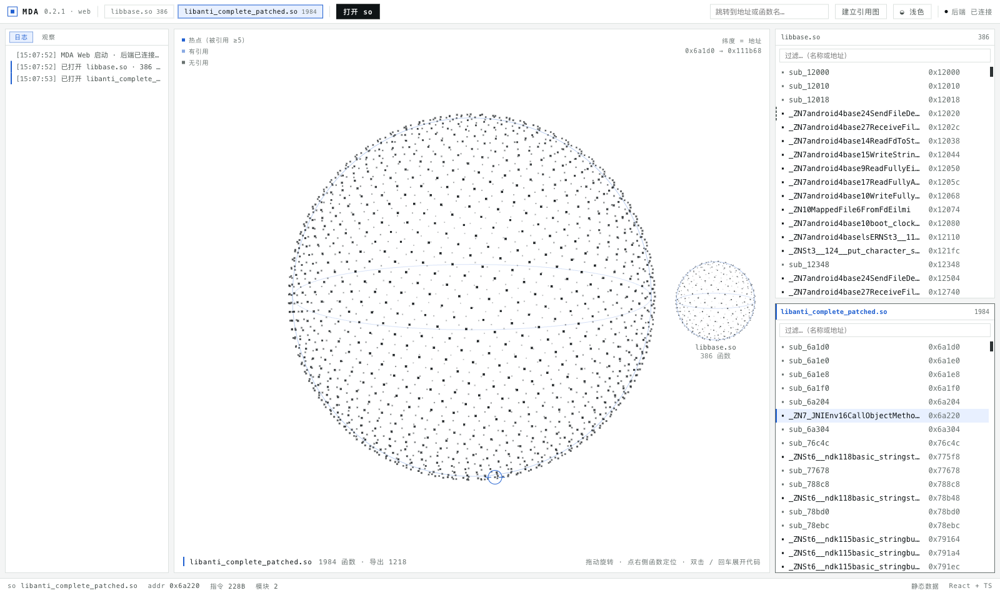
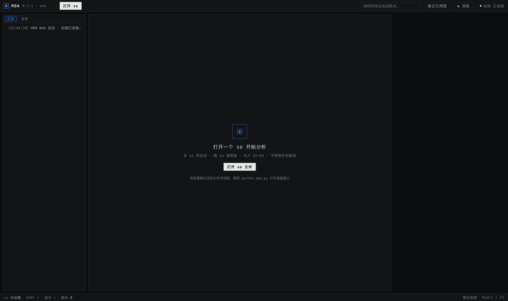
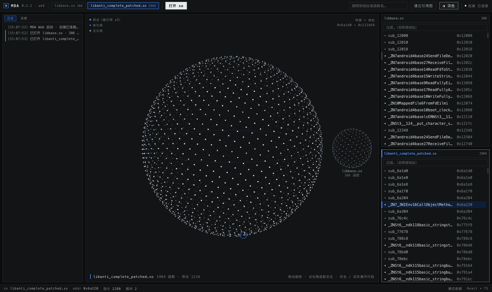
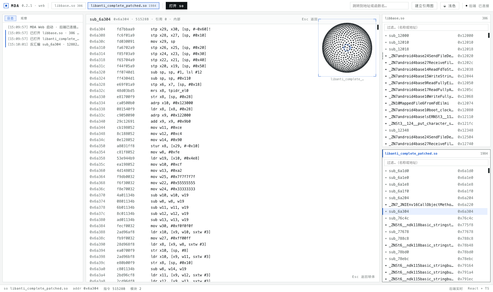
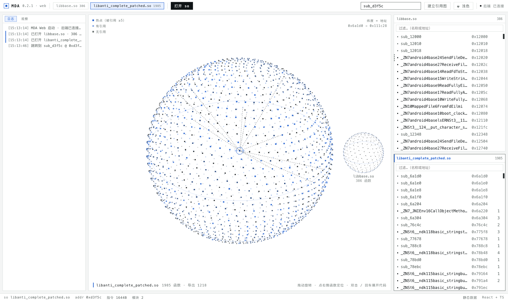

<div align="center">
  

  # MDA — Multi-so Disassembly Analyzer

  **轻量级多 so 静态分析器 · 内置 MCP 供 AI 直接驱动**

  多 so 同会话 · 跨 so 调用链 · 函数球可视化 · 人机同屏
</div>

---

## 这是什么

IDA 无法直接分析**多个 so 之间的调用链路**。MDA 为此而生：

- **多 so 同会话**：一次加载多个 so，跨模块解析 PLT → GOT → 导出符号，还原完整调用树
- **函数球**：每个点是一个函数，纬度按地址排序，颜色按被引用次数分级——一眼看出热点与引用关系
- **内置 MCP**：程序启动即开 MCP 服务，AI（Claude / DeepSeek / Cursor…）可直接加载文件、反汇编、追调用链、跑 IDC 脚本
- **人机同屏**：AI 每调一次工具，界面同步高亮那个函数、弹出操作卡、滚动日志——你能**看着 AI 干活**
- **加固样本友好**：节表被抹、FDE 不全、控制流平坦化都能处理

## 界面

界面用 **React + TypeScript** 写，跑在本机 **WKWebView**（系统 WebView，不打包 Chromium）。



**三栏布局**

- **左**：日志（AI 的每次工具调用）/ 观察列表
- **中**：函数球——当前 so 放大居中，其余 so 缩成小球停在两侧并显示名字
- **右**：按 so 分组的函数列表，支持过滤，AI 定位时会自动滚动并高亮

**操作**

| 动作 | 效果 |
|---|---|
| 拖动球体 | 旋转，看不同纬度的函数分布 |
| 点右侧函数 | 球旋转到该点正面，状态栏显示地址/大小/引用数 |
| 双击 / 回车 | 反汇编铺满舞台，球缩成右上角方形缩略图 |
| `Esc` | 从代码返回球体 |
| 顶部跳转框 | 输入 `0x621d0` 或函数名，跨 so 定位 |
| 拖入 `.so` | 松手即加载（也可以点「打开 so」走系统文件对话框） |
| 「建立引用图」 | 真实构建引用图，完成后点云按引用热度着色、画出调用关系线 |

**主题**：默认跟随系统深浅色（`prefers-color-scheme`），点顶部按钮可手动锁定。

<p>
  
  
</p>

**代码视图**（真实 ARM64，12k+ 条指令也能秒开——虚拟滚动，DOM 里只保留可视区域）



**引用关系**（蓝点=被引用/热点，关系线=调用者与被调用者，来自真实 xref 计算）



## 安装

### 方式一：下载 macOS 客户端（推荐）

到 [Releases](https://github.com/xipeng5/Mda/releases) 下载最新的
`MDA-<版本>-macos-arm64.zip`（或 `.dmg`）：

1. 解压后把 **MDA** 拖进 **Applications**
2. 从启动台打开

> 首次打开若提示「无法验证开发者」（未签名应用的正常提示）：
> **右键 → 打开**，或执行 `xattr -dr com.apple.quarantine /Applications/MDA.app`
>
> 当前包是 **Apple Silicon (arm64)**；Intel 机器请用源码方式运行。

### 方式二：从源码运行

```bash
git clone https://github.com/xipeng5/Mda.git
cd Mda
python3 -m venv .venv
.venv/bin/pip install -r requirements.txt

# 前端只构建一次；改前端代码后重跑
cd web && npm install && npm run build && cd ..

.venv/bin/python app.py
```

> 需要 Python 3.11+ 与 Node 18+（开发环境 Python 3.11.15 / Node 22）。

## 使用

### 启动

```bash
.venv/bin/python app.py
```

会启动本地服务（`127.0.0.1:8766`，同时托管前端）并打开原生窗口；
内置 MCP 服务监听 `127.0.0.1:8765`，**AI 与界面共享同一份会话**。

启动后是空状态，打开或拖入一个 so 开始：

```bash
# 也可以从命令行直接分析（不开界面）
.venv/bin/python mda.py analyze libfoo.so
.venv/bin/python mda.py chain libfoo.so 0x1234
```

### 端口

| 端口 | 用途 |
|---|---|
| `8766` | 界面 + HTTP API（`/api/*`） |
| `8765` | MCP 服务（AI 接入），可用 `MDA_MCP_PORT` 覆盖 |

> 同机只能跑一个实例：第二个实例的 MCP 会因端口占用而跳过（界面日志里会提示）。

## 接入 AI（MCP）

### 一键复制配置

点右上角 **「复制 MCP 配置」**，剪贴板里会得到：

```json
{
  "mcpServers": {
    "mda": { "url": "http://127.0.0.1:8765/mcp" },
    "mda-stdio": {
      "command": "/绝对路径/Mda/.venv/bin/python",
      "args": ["/绝对路径/Mda/app.py", "--mcp-stdio"]
    }
  }
}
```

粘到 AI 客户端的 `mcpServers` 里，删掉不用的那条即可。**路径与端口按当前运行形态自动生成**，
打包版会给出 `.app` 可执行文件加 `--mcp-stdio`，不用手写。

> `--mcp-stdio` 会自动探测正在运行的界面并把请求转发过去；界面没启动时退化为进程内独立分析。

### 联动效果

- AI 用 `load_so` 加载 so → 界面**自动出现**该模块
- AI 调 `disassemble` / `xrefs_to` → 球旋转定位，弹出「AI 操作」卡，日志记录耗时
- AI 加载的会话与你手动加载的是**同一份**数据

### 工具（35 个）

| 类别 | 工具 |
|---|---|
| 加载/概览 | `load_so` `list_modules` `metadata` `segments` |
| 函数 | `list_functions` `function_by_name` `rename_function` `disassemble` `decompile` |
| 引用 | `build_xrefs` `xrefs_to` `xrefs_from` `call_chain` `callers_of` `string_refs` |
| 数据 | `list_strings` `search_bytes` `imports` `exports` `set_comment` `get_comments` |
| 脚本 | `run_script`（Python）`run_idc` / `run_idc_file`（IDC 直译） |
| 插件 | `list_plugins` `plugin_run` |
| 动态 | `list_devices` `list_processes` `start_frida` `runtime_modules` `set_breakpoint` `read_process_memory` `wait_hits` `resume` `list_breakpoints` |

> 性能约定：查单个函数用 `session.ensure_function(so, addr)`（毫秒级）；
> 只有确实需要全库引用时才调 `session.ensure_xrefs(so)`（6000+ 函数约 10–20 秒，有缓存）。

## IDC 脚本支持

直接跑现成的 IDA IDC 脚本（翻译成 Python 执行）：

```bash
run_idc_file  so_name=libfoo.so  path=/path/to/script.idc
```

已覆盖真实脚本里高频的 API：`MakeName` `MakeFunction` `MakeCode` `set_cmt`
`is_code` `get_flags` `del_items` `Message` `Byte/Word/Dword`，
支持 `if / else if / while / BADADDR` 等语法。

## 动态分析（AI 驱动）

动态能力**只在 MCP 侧提供**，界面不暴露按钮——原因很直接：断点是「停下 → 看寄存器 → 放行」
的交互，而且一旦挂起，没人处理会把目标 App 拖到 ANR。所以：

- **AI 操作**：`list_devices` → `list_processes` → `start_frida` → `set_breakpoint` → `wait_hits` → `resume`
- **界面负责展示**：AI 的每次调用都进日志，命中地址会自动跳到对应函数
- 断点状态由后端单例持有，`set_breakpoint` 跨调用存活，`list_breakpoints` 可随时查

设备需要 root，并自行 push frida-server（仓库不含二进制）：

```bash
adb push frida-server-<版本>-android-arm64 /data/local/tmp/frida-server
adb shell "chmod 755 /data/local/tmp/frida-server"
```

> **版本必须匹配**：客户端 `frida` 与设备端 `frida-server` 大版本要一致，
> 否则会报 `ProtocolError: unable to communicate with remote frida-server`。
> 启动失败时 `start_frida` 会返回明确原因（`FRIDA_BINARY_MISSING` / `FRIDA_NO_ROOT` / `FRIDA_START_FAILED`），
> 不再只回一个 `false`。

## 架构

```
web/          React + TypeScript 前端（Vite 构建，产物被后端托管）
server/       Starlette 传输层：静态托管 + REST + WebSocket（8766）
core/         ELF 解析、反汇编、引用图、函数发现、字符串、伪代码
mcp_server/   MCP 工具层（35 个工具）、HTTP 服务、stdio→进程内代理
dyn/          adb / frida / ASLR 换算 / 动态会话注册表
scripting/    Python 脚本执行器、IDC 直译器
plugins/      可插拔分析插件（敏感字符串扫描、函数画像）
tests/        回归与冒烟测试
```

**数据流**：界面 → `server/api.py` → `core.Session`（与 MCP 共用同一实例）→ 返回 JSON；
AI → MCP 工具 → 同一个 `Session` → 通过 `on_activity` / `on_ui_sync` 推事件到
`/api/events`（WebSocket）→ 界面同步表现。

### HTTP API

| 接口 | 说明 |
|---|---|
| `GET /api/health` `GET /api/modules` | 服务状态、已加载的 so |
| `POST /api/load` `POST /api/load_upload` | 按路径 / 按上传字节加载 |
| `GET /api/functions` `GET /api/disasm` | 函数表（含引用数）、反汇编 |
| `GET /api/xrefs` `GET /api/strings` `POST /api/xrefs/build` | 引用、字符串、构建引用图 |
| `GET /api/mcp-config` | 生成给 AI 用的 MCP 配置 |
| `WS /api/events` | AI 活动、UI 回放、引用图进度 |

## 打包

```bash
.venv/bin/pip install pyinstaller
PYINSTALLER_CONFIG_DIR=$PWD/.pyinstaller .venv/bin/pyinstaller packaging/mda.spec --noconfirm
open dist/MDA.app
```

产物 `dist/MDA.app`（约 154MB，其中 frida 运行库占 94MB）；分发包建议压成 zip（约 67MB）：

```bash
cd dist && zip -qry MDA-<版本>-macos-arm64.zip MDA.app
```

做成 dmg（需要在有权限的普通终端里执行，沙箱环境不允许 `hdiutil` 建映像）：

```bash
rm -rf dist/dmg_root && mkdir -p dist/dmg_root
cp -R dist/MDA.app dist/dmg_root/
ln -s /Applications dist/dmg_root/Applications
hdiutil create -volname "MDA <版本>" -srcfolder dist/dmg_root -ov -format UDZO \
  dist/MDA-<版本>-macos-arm64.dmg
```

> 打包两个坑（已在 spec/命令里处理）：
> ① `collect_submodules("mcp")` 会 import `mcp.cli`（依赖 typer 且 import 期 `sys.exit(1)`），必须 `filter=` 排除；
> ② PyInstaller 缓存默认在 `~/Library/...`，受限环境用 `PYINSTALLER_CONFIG_DIR` 重定向到项目内。

## 开发

```bash
# 前端热更新（改完仍由后端 8766 提供真实接口）
cd web && npm run dev        # http://localhost:5173

# 类型检查 + 生产构建
cd web && npm run build
```

前端源码结构：

```
web/src/App.tsx              布局、状态、AI 事件接线
web/src/components/SphereCanvas.tsx   球体画布（拖拽/旋转/选中）
web/src/lib/sphere.ts        球面投影、分桶绘制、关系线、进度环
web/src/components/CodeOverlay.tsx    代码视图（虚拟滚动）
web/src/components/LeftPanel.tsx      日志 / 观察
web/src/components/RightPanel.tsx     函数列表（虚拟滚动）
```

## 测试

```bash
# 静态链路冒烟（随机端口，真 so）
.venv/bin/python tests/ui_review/smoke_web_api.py

# MCP 联动探针（需要界面在跑）
MDA_MCP_PORT=8765 .venv/bin/python tests/ui_review/mcp_probe.py
```

> 测试需要样本 so。仓库**不收录他人二进制**，请自备 AOSP 的
> `liblog.so` / `libbase.so` / `libcutils.so` 放入 `samples/`。

## 说明

- 仓库**不含**任何第三方 App 的 so 样本，也不含 frida-server 二进制。
- `docs/verification.md` 是开发过程中的缺陷与修复记录，含实测数据，可作
  「如何验证一个反汇编器是否正确」的参考。
- Qt 界面已移除，当前只有 Web 界面（`ui/` 目录不再存在）。

## 许可

MIT
