<div align="center">
  

  <h1>MDA — Multi-so Disassembly Analyzer</h1>

  <p>
    <strong>AI 原生的多 SO 静态分析与真机动态调试工作台</strong><br>
    <em>多 SO 同会话 · F5 结构化伪 C · CFG 控制流 · 140 个 MCP 工具 · 24 个逆向插件 · Android 设备工具箱</em>
  </p>

  <p>
    <strong>简体中文</strong> &nbsp;|&nbsp; <a href="README.en.md">English</a>
  </p>

  <p>
    
    
    
    
    
    
    
  </p>

  <p>
    <a href="#核心能力">核心能力</a> ·
    <a href="#studio-v2-界面画廊">界面画廊</a> ·
    <a href="#安装与启动">安装与启动</a> ·
    <a href="#接入-aimcp">接入 AI (MCP)</a> ·
    <a href="#140-个-mcp-工具全景">140 MCP 工具</a> ·
    <a href="#24-个可插拔分析插件">24 插件</a> ·
    <a href="#典型-ai-分析链路">实战链路</a> ·
    <a href="#项目架构与开发">架构与打包</a>
  </p>

  <br>

  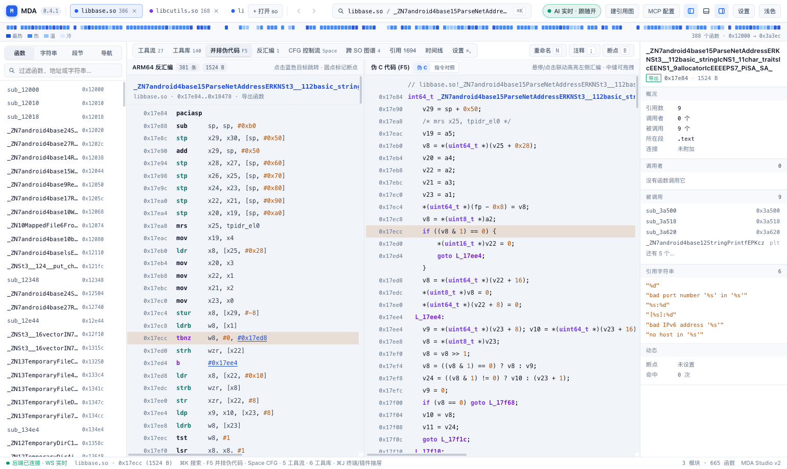
  <p><sub>MDA Studio v2（v0.4.1）：多 SO 标签、全局引用密度热力条、F5 反汇编与结构化伪 C 双向高亮联动、右侧函数检视器</sub></p>
</div>

---

## 这是什么

**MDA（Multi-so Disassembly Analyzer）** 是一款面向移动安全与底层逆向的 **AI 驱动型综合分析平台**。  
核心理念是 **「静态看清结构，动态看真值，人机共享同一会话」** —— AI 通过内置 **140 个 MCP 工具**与 **24 个分析插件**自主推进从静态定位到真机验证的完整链路，而你在 **Studio v2** 桌面工作台里实时观看每一步推理、代码定位、调用图谱与设备运行态。

> **与 IDA Pro 的取舍**  
> IDA 更擅长单文件交互式人工精读；MDA 专注 **多 SO 跨模块调用还原**、**无节表/加固壳静态分析**、**真机原生 + Java + VM 一体化动态调试**，以及 **让 AI Agent 端到端闭环执行整条逆向链路**。

---

## 核心能力

| 能力域 | 核心特性 |
|---|---|
| **多 SO 同会话 & 跨模块解析** | 同时载入多个 ELF/SO，自动穿透 `PLT → GOT → 导出符号` 还原跨模块调用树，并在图谱中以紫色虚线直观标注跨 SO 调用边。 |
| **Studio v2 桌面工作台** | 原生 **WKWebView**（不打包 Chromium），提供 **F5 反汇编 + 结构化伪 C 并排双向高亮**、**Space 基本块 CFG**、**⌘K 全局命令面板**、**⌘J 插件/Frida 终端抽屉**与浅色/深色双主题。 |
| **加固与无节表样本友好** | 不依赖 `.shstrtab`/节表，直接解析 `PT_LOAD` / `PT_DYNAMIC`；提供 `bl_only` / `strict` / `loose` 三档递归函数发现、RELA/RELR 重定位与虚表（vtable）识别、JNI 注册表与 4 种 switch 跳转表全库扫描。 |
| **DEX / APK 纯静态分析** | 无需解压到磁盘，直接解析 APK 内多 `classes*.dex` 的类、方法签名、`native` 标记、Dalvik 字节码反汇编及全库 `invoke-*` 调用者反查。 |
| **真机深度动态调试栈** | Frida 17 真断点与 `auto_resume_after_ms` 防 ANR 自动放行、36 寄存器与运行时字节解码、**DWARF CFI 独立栈回溯**、内核 **`perf_event` 硬件观察点**、**内核 `uprobe` 分配追踪**、匿名内存快照 `mem_diff`、VM 派发点断点与执行轨迹。 |
| **Java 层与行为监控** | 自动注入 Frida 17 `java.js` 桥接；支持通配符批量 `java_hook`、0 命中同类探测与热方法三级自动降级、全线程 Java 栈快照、加密/文件/Activity/assets 行为监控。 |
| **Android 设备工具箱 & UI 自动化** | 设置页与 MCP 双入口：一键配置手机全局代理与 Magisk `mitmproxy` 系统证书、冻结/解冻 App（`pm suspend`）、强停与清数据重启（`pm clear`），并内置 `ui_dump`/`ui_click` 等无注入界面自动化工具。 |
| **24 个可插拔分析插件** | 集成 **angr**（子进程真反编译/符号执行）、**Unicorn**（ARM64 离线函数模拟 + 桩库）、**Z3**（约束求解）、**YARA**（加密常量识别）、**LIEF**（ELF 增强解析）、结构体推断、字符串池解密、OLLVM 混淆检测、模板化穷举拼接等。 |

---

## Studio v2 界面画廊

### 1. F5 并排对照：ARM64 反汇编 + 结构化伪 C（浅色 / 深色双主题）

- **结构化伪 C 生成器（`server/core/pseudocode_c.py`）**：自动折叠栈帧与 `adrp`/`cmp`/`bl` 参数、推断函数入参与局部变量、内联还原 `.rodata` 字符串与符号名，同时保留每行真实源地址。
- **双向联动**：在反汇编与伪 C 间悬停或点击任意一行，左右两侧同步高亮；支持拖拽中缝自由调节比例，支持「伪 C / 指令对照」切换、行内断点圆点（`B`）、原地重命名（`N`）与行内注释（`;`）。

<table>
  <tr>
    <td width="50%">
      
      <p align="center"><sub><b>浅色主题</b>：点击 <code>0x17ecc</code>，左侧汇编与右侧伪 C 同步高亮联动</sub></p>
    </td>
    <td width="50%">
      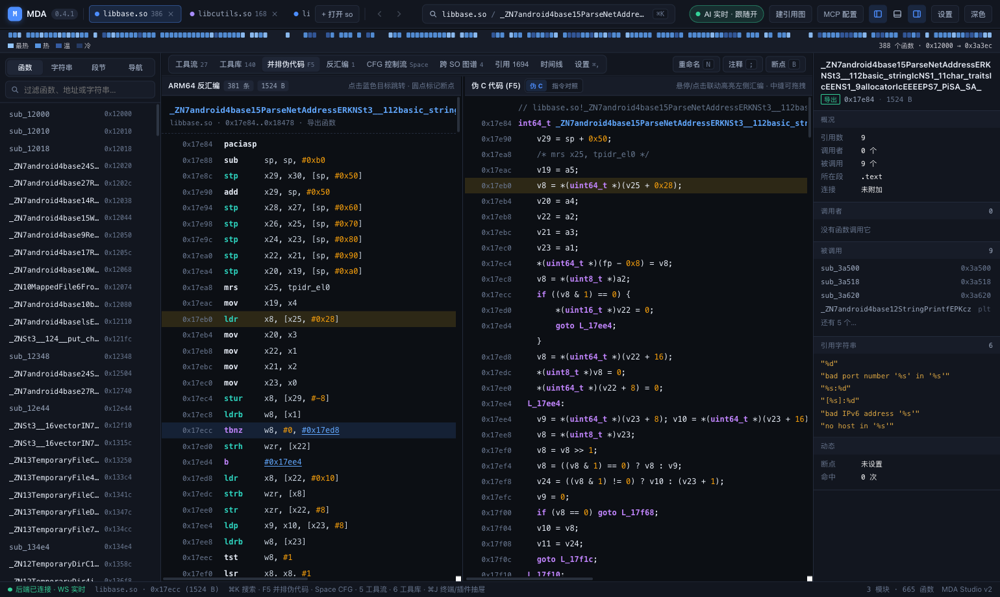
      <p align="center"><sub><b>深色主题</b>：切换至 <code>libcutils.so!ashmem_create_region</code>，完整语法着色</sub></p>
    </td>
  </tr>
</table>

---

### 2. 跨 SO 调用图谱 & Space 基本块控制流图（CFG）

- **跨 SO 图谱（`4`）**：固定三层清晰拓扑（调用者 / 当前焦点 / 被调用），**蓝色实线**代表同模块调用，**紫色虚线**代表跨 SO 调用（例如 `libcutils.so` 多个导出函数跨模块调用 `liblog.so!__android_log_print`），单击聚焦、双击直达代码。
- **CFG 控制流图（`Space`）**：自动切分 ARM64 基本块，用 **绿色（True 条件跳转）/ 红色（False 顺序落入）/ 蓝色（无条件跳转）** 清晰区分路径，支持滚轮缩放、拖拽画布与点击基本块直达汇编行。

<table>
  <tr>
    <td width="50%">
      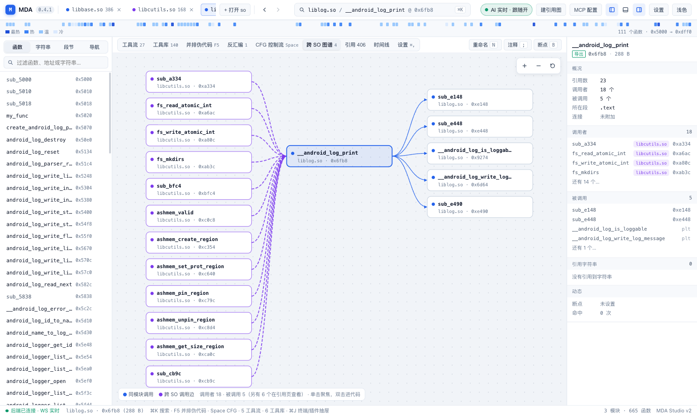
      <p align="center"><sub><b>跨 SO 图谱</b>：<code>libcutils.so</code> 18 处跨模块调用汇聚至 <code>liblog.so!__android_log_print</code></sub></p>
    </td>
    <td width="50%">
      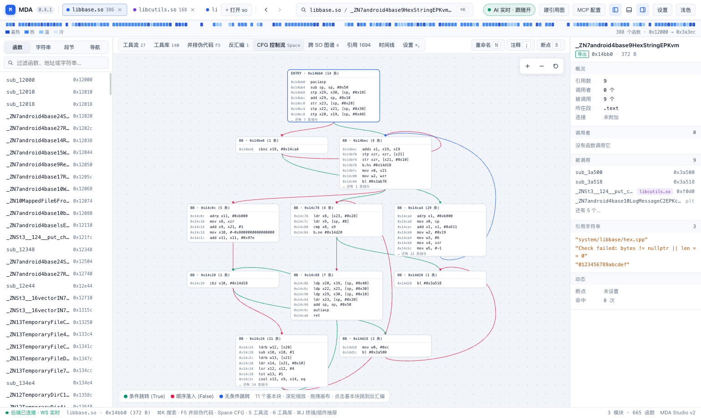
      <p align="center"><sub><b>CFG 控制流图</b>：<code>HexString</code> 11 个基本块与条件分支路径，右栏同步呈现引用字符串</sub></p>
    </td>
  </tr>
</table>

---

### 3. 双向交叉引用 & 字符串 / 段节浏览

- **引用视图**：左右两栏并列展示全部调用者（Callers）与被调用者（Callees），标注「导出」与所属 SO，一键跳转。
- **左栏多维切换**：在 **函数 / 字符串 / 段节 / 导航（静态·动态·VM·行为·工具五组实时计数）** 之间即时切换，全局顶部 **引用密度热力条** 始终按真实地址映射全库热点。

<table>
  <tr>
    <td width="50%">
      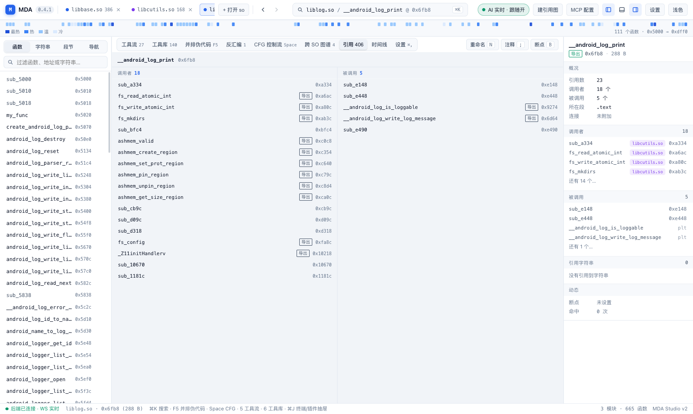
      <p align="center"><sub><b>双向交叉引用</b>：调用者（18）与被调用（5）两栏对照，附带导出与地址索引</sub></p>
    </td>
    <td width="50%">
      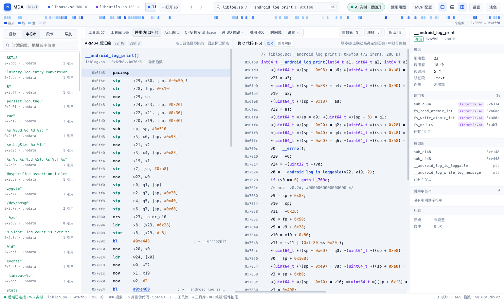
      <p align="center"><sub><b>左栏字符串表 + 伪 C 联动</b>：实时列出 <code>.rodata</code> 常量与引用次数</sub></p>
    </td>
  </tr>
</table>

---

### 4. 人机同屏：实时工具流、AI ↔ 设备信号总线 & 调用时间线

- **AI MCP 实时监控台（`5`）**：顶部配备 4 通道 SVG 光粒子信号总线舞台，实时可视化 AI 对「进程与系统链路 / 行为 Hook & UI / Native SO 内存段 / 断点 & ARM64 寄存器」四层的操作脉冲；下方三栏同步展示目标设备状态、实时事件流、底部 6 通道活动密度泳道与完整 JSON 入参/返回。
- **调用时间线**：按每次 MCP 工具调用的真实耗时绘制 `√` 压缩甘特条，自动置顶最慢热点，方便排查分析瓶颈。

<p align="center">
  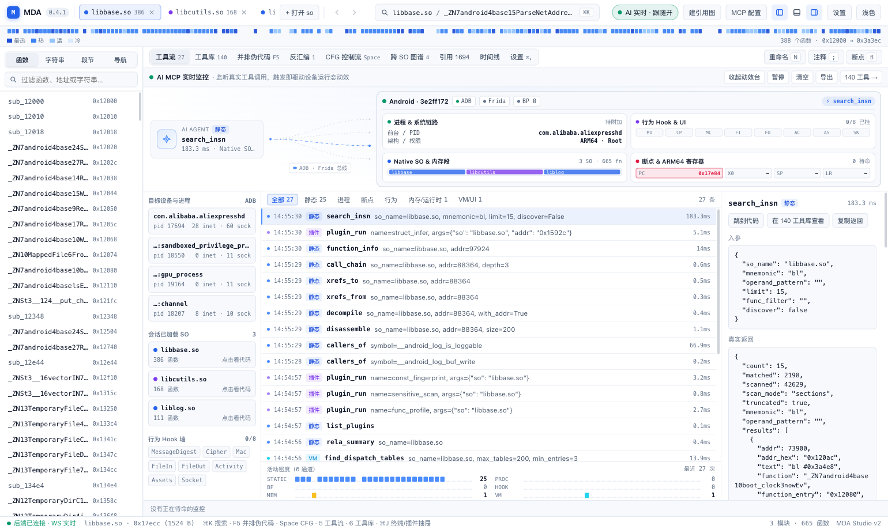
  <sub><b>实时监控台</b>：AI ↔ Android 设备 4 通道信号总线、会话已加载 SO、实时工具调用事件流与 JSON 详情面板</sub>
</p>

<p align="center">
  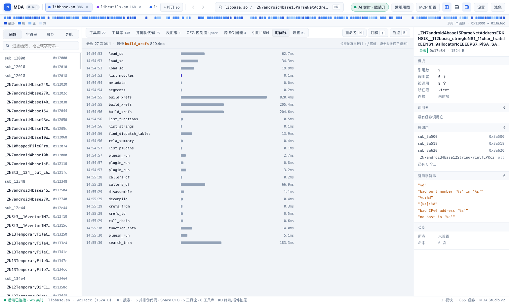
  <sub><b>调用时间线</b>：记录每次 AI 工具调用真实耗时与执行次序，自动高亮最慢调用</sub>
</p>

---

### 5. 140 个 MCP 工具库 · ⌘K 全局命令面板 · ⌘J 插件与 Frida 终端抽屉

- **工具库（`6`）**：直接读取后端 MCP 注册表列出全部 **140 个真实工具**，按 12 类筛选，AI 调用时对应条目实时显示次数脉冲并自动滚入视野；点选即可查看完整文档与参数 Schema。
- **底部可拖拽抽屉（`⌘J`）**：集成了 **插件快捷分析**（一键运行 `struct_infer` 结构体推断 / `sensitive_scan` 敏感信息扫描 / `func_profile` 热函数画像）与 **Frida 实时输出终端**（支持一次性 `once` 与常驻 `keep` 脚本，`console.log` 自动流式回显）。
- **全局命令面板（`⌘K`）**：零鼠标操作，跨全部已加载模块秒搜任意函数、地址、140 个 MCP 工具或视图命令。

<p align="center">
  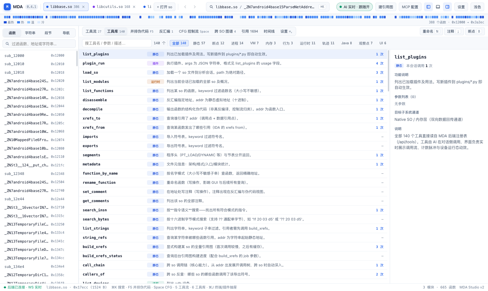
  <sub><b>140 个 MCP 工具库</b>：按静态/断点/进程/VM/内存/行为/轨迹/Java/观察点/UI 分类筛选，附带调用计数与完整说明</sub>
</p>

<table>
  <tr>
    <td width="50%">
      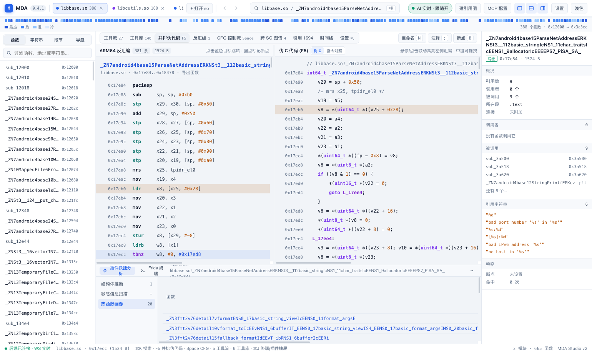
      <p align="center"><sub><b>⌘J 底部抽屉</b>：上方阅读 F5 伪 C，下方同屏查看热函数画像 / 结构体推断或 Frida 终端</sub></p>
    </td>
    <td width="50%">
      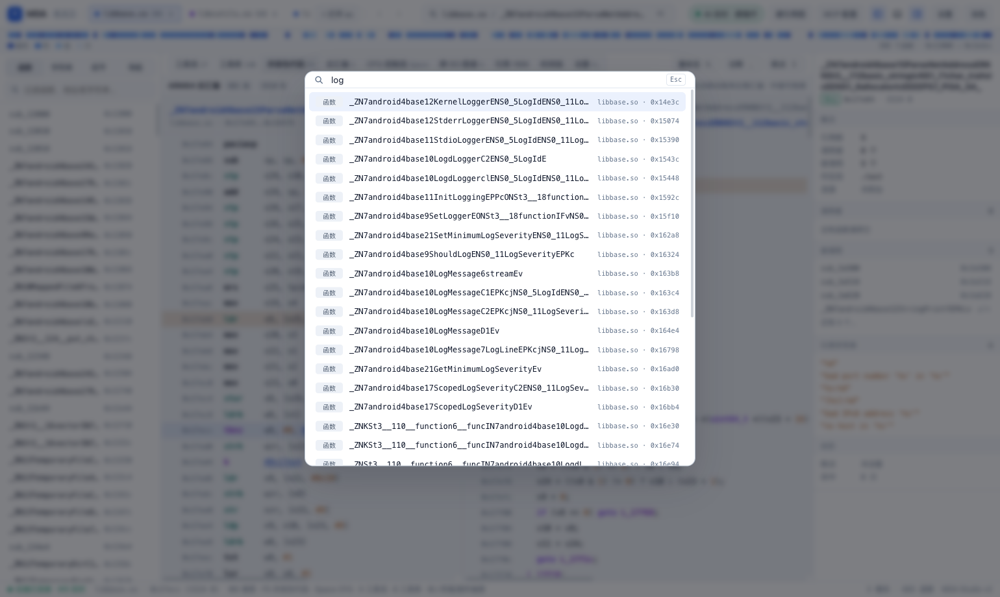
      <p align="center"><sub><b>⌘K 命令面板</b>：跨多 SO 模糊搜索函数、地址、140 个工具与快捷视图</sub></p>
    </td>
  </tr>
</table>

---

### 6. 设置 & Android 设备常用工具箱（`⌘,`）

与 MCP 工具（`device_proxy`、`device_app_suspend`、`device_app_reset`）共用同一套真机执行引擎，支持 **手工点击** 与 **AI 对话控制** 双入口：

- **手机全局代理 & mitmproxy 系统证书**：自动检测本机局域网 IP 与手机 `wlan0` IP，同时读写 4 项系统代理键（适配小米等 ROM），支持 Magisk 持久化 + 即时生效的系统根证书安装与卸载。
- **常用 App 快捷管理**：一键将当前前台或已安装 App 存为常用（自动解析真实应用名），单行提供 **冻结（`pm suspend`，阻止深链自动跳 App）/ 解冻 / 强停 / 清数据重启（`pm clear`）**。

<p align="center">
  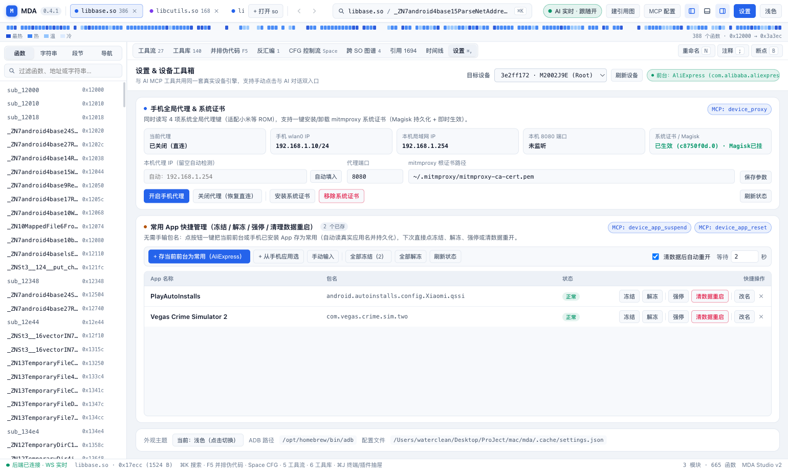
  <sub><b>设置 & 设备工具箱</b>：手机全局代理、Magisk 系统证书状态与常用 App 一键冻结/重置管理</sub>
</p>

---

### 键盘快捷键速查

| 快捷键 | 功能 | 快捷键 | 功能 |
|---|---|---|---|
| `⌘K` / `Ctrl+K` | 打开全局命令面板（跨模块搜函数/工具） | `F5` | 在「并排伪代码」与「全宽反汇编」间切换 |
| `Space` | 切换 CFG 基本块控制流图 | `1` / `4` | 切至全宽反汇编 / 跨 SO 调用图谱 |
| `5` / `6` | 切至实时工具流 / 140 工具库 | `⌘,` | 打开/关闭设置与 Android 设备工具箱 |
| `⌘J` | 展开/收起底部抽屉（插件快捷分析 & Frida 终端） | `⌘B` / `⌘I` | 折叠/展开左侧栏 / 右侧函数检视器 |
| `N` | 原地重命名当前函数（AI 与界面同步） | `;` | 在当前指令地址添加/编辑行内注释 |
| `B` | 在当前指令地址切换断点标记 | `Alt+←` / `Alt+→` | 导航历史后退 / 前进 |

---

## 安装与启动

### 方式一：下载 macOS 客户端（推荐）

前往 [Releases](https://github.com/xipeng5/Mda/releases) 下载最新的 `MDA-<版本>-macos-arm64.zip`：

1. 解压后将 **`MDA.app`** 拖入 **`/Applications`**
2. 从启动台打开即可使用

> **首次打开提示「无法验证开发者」**（未签名应用的 macOS 常规提示）：  
> **右键 → 打开**，或在终端执行：
> ```bash
> xattr -dr com.apple.quarantine /Applications/MDA.app
> ```
> 当前预构建包面向 **Apple Silicon (arm64)**；Intel Mac / Linux 请使用源码方式运行。

### 方式二：从源码运行

需要 **Python 3.11+** 与 **Node.js 18+**（开发环境实测：Python 3.11.15 / Node 22）。

```bash
git clone https://github.com/xipeng5/Mda.git
cd Mda

python3 -m venv .venv
.venv/bin/pip install -r requirements.txt

# 构建 Studio v2 前端（仅首次或修改前端代码后需要）
cd web && npm install && npm run build && cd ..

# 启动桌面工作台（同时启动 8766 UI/API 与 8765 MCP 服务）
.venv/bin/python app.py
```

也可以脱离界面直接从命令行进行静态分析：

```bash
.venv/bin/python mda.py analyze libfoo.so
.venv/bin/python mda.py chain libfoo.so 0x1234
```

### 服务端口

| 端口 | 用途 | 环境变量覆盖 |
|---|---|---|
| `127.0.0.1:8766` | Studio v2 界面 + HTTP API + WebSocket (`/api/events`) | `MDA_API_PORT` |
| `127.0.0.1:8765` | 内置 MCP 服务（Streamable HTTP，与界面共享会话） | `MDA_MCP_PORT` |

> 同机仅建议运行一个 GUI 实例；若 8765 被已有实例占用，第二个实例会自动跳过 MCP 启动并在状态日志中提示。

---

## 接入 AI（MCP）

点击顶栏右上角 **「MCP 配置」** 按钮，一键复制当前运行形态（源码版或 `.app` 打包版）对应的真实配置到剪贴板：

```json
{
  "mcpServers": {
    "mda": {
      "url": "http://127.0.0.1:8765/mcp"
    },
    "mda-stdio": {
      "command": "/绝对路径/Mda/.venv/bin/python",
      "args": ["/绝对路径/Mda/app.py", "--mcp-stdio"]
    }
  }
}
```

粘贴到任意支持 MCP 的 AI 客户端（如 DeepSeek Harness、Claude Desktop、Cursor 等），按偏好保留 HTTP 或 stdio 其中一条即可：

- **自动会话转发**：`--mcp-stdio` 会自动探测本地正在运行的 MDA GUI 并将请求转发过去，实现 **人机同屏联动**；若 GUI 未打开，则自动退化为进程内独立分析模式。
- **实时联动表现**：AI 调用 `load_so` → 界面自动出现模块标签与热力条；AI 调用 `disassemble` / `decompile` / `xrefs_to` → 代码区自动跟随定位、闪烁脉冲并记入工具流与时间线。

---

## 140 个 MCP 工具全景

所有工具按能力分为 11 组，点击展开查看完整列表（完整参数 Schema 以运行期 `tools/list` 及 [docs/manual-dynamic.md](docs/manual-dynamic.md) 为准）：

<details open>
<summary><strong>1. 模块管理、静态结构与元信息（7 个）</strong></summary>

| 工具 | 说明 |
|---|---|
| `load_so` `unload_so` `clear_modules` | 加载 / 单个卸载 / 批量释放模块（只清静态缓存，不影响设备进程） |
| `list_modules` `module_memory` | 查看已加载 SO 概况与各模块估算内存占用 |
| `metadata` | 架构、ELF 格式、入口点与模块统计 |
| `segments` | 分离输出 `PT_LOAD`/`PT_DYNAMIC` 程序头与节表（**无节表加固样本可用**） |

</details>

<details open>
<summary><strong>2. 函数发现、反汇编、伪代码、标注与语义搜索（17 个）</strong></summary>

| 工具 | 说明 |
|---|---|
| `discover_functions` | 三档递归补全函数表（`bl_only` / `strict` 完整栈帧 / `loose`） |
| `list_functions` `function_by_name` `get_function_by_address` `function_info` | 函数列表（支持按 size 排序）、按名/按址查函数、函数综合画像 |
| `disassemble` `export_disasm` `decompile` | ARM64 反汇编、导出（asm/json/csv）、带源地址注释的结构化伪代码 |
| `imports` `exports` | 导入 / 导出符号表过滤 |
| `list_strings` `string_refs` `read_string` | 字符串枚举、引用者反查、按静态/运行时地址读 C 串 |
| `read_typed` `read_pointer` | 按标量/数组类型读取静态或运行时数据、多级指针解引用跟链 |
| `search_insn` `search_bytes` | **指令语义通配搜索**（如 `str` + `[x*, #0x1100]`）与十六进制字节通配搜索 |
| `rename_function` `set_comment` `get_comments` | 函数重命名与地址注释（AI 与 Studio v2 界面实时共享） |

</details>

<details>
<summary><strong>3. 引用图、跨 SO 调用链、重定位与虚表（9 个）</strong></summary>

| 工具 | 说明 |
|---|---|
| `build_xrefs` `build_xrefs_status` | 异步/缓存构建全量引用图（支持三档函数补全与后台进度轮询） |
| `xrefs_to` `xrefs_from` | 双向查询代码调用点与数据/字符串引用点 |
| `call_chain` `get_callees` `callers_of` | 跨 SO 递归展开调用树、跨 SO 反查导出符号的全部调用方 |
| `rela_summary` `rela_dump` `vtable_at` | 解析 `.rela.dyn` / `.rela.plt` / `RELR` / `PT_DYNAMIC` 重定位表并三层判定 vtable 虚函数槽 |

</details>

<details>
<summary><strong>4. 加固样本入口与跳转表还原（4 个）</strong></summary>

| 工具 | 说明 |
|---|---|
| `find_jni_registrations` | 扫描 `JNINativeMethod` 动态注册表，自动结合 RELA 补全 `fnPtr`，一次拿到全部 JNI 名字↔地址映射 |
| `find_dispatch_tables` | 全库一次性扫描 `switch` 跳转表（覆盖有符号偏移、绝对指针表、字节索引表） |
| `resolve_br` `read_jump_table` | 逆向回溯 `adrp/ldr/br xN` 间接跳转，支持**静态与运行时进程内存双模式**读表 |

</details>

<details>
<summary><strong>5. DEX / APK 纯静态字节码分析（4 个）</strong></summary>

| 工具 | 说明 |
|---|---|
| `dex_classes` | 免解压遍历 `.dex` / `.apk`（含多 `classes*.dex` 合并）内的全部类与继承关系 |
| `dex_methods` | 列出类下全部方法原型、寄存器数、`is_native` / `is_abstract` 标记 |
| `dex_disasm` | 按精确 Dalvik code unit 偏移反汇编字节码（完整处理 switch/array payload） |
| `dex_callers` | 静态扫描全 DEX `invoke-*` 指令，精确反查某 Java 方法的所有调用点 |

</details>

<details>
<summary><strong>6. 真机动态调试、断点与栈回溯（29 个）</strong></summary>

| 工具 | 说明 |
|---|---|
| `list_devices` `preflight` | 列出 ADB 设备；一键体检 ADB、Root、Frida 版本匹配与 27042 端口占用者 |
| `start_frida` `stop_frida` `frida_server_align` | 仅管理 27042 端口的 frida-server；自动下载校验并对齐设备端与本机版本（支持 `dry_run` 与自动回滚） |
| `list_processes` `probe_process` `list_app_processes` `probe_network_processes` | 进程枚举、三条证据交叉验证死活与可注入性、识别多进程 App 中谁在跑网络 |
| `runtime_modules` `locate_runtime_addr` | 运行时模块基址列表、ASLR 运行时地址折回静态函数与偏移 |
| `set_breakpoint` `remove_breakpoint` `list_breakpoints` `dedupe_breakpoints` `verify_breakpoint` | 真断点（支持 `hold=True` + `auto_resume_after_ms` 防 ANR）、真摘钩、按运行地址去重与 armed 校验 |
| `wait_hits` `poll_events` `hits` `clear_hits` `resume` `hit_analysis` | 等待命中、增量事件流、按寄存器过滤/聚合的命中历史（`filter` / `group_by`）、放行与一站式命中静态上下文 |
| `read_process_memory` `read_runtime_memory` `read_runtime_string` `read_memory_batch` `decode_runtime_insn` | 静态偏移/运行时绝对地址内存读取、批量读、从进程内存实时解码 ARM64 指令（识别热补丁/自解密字节） |
| `list_threads` `get_callstack` | 线程列表；支持 `accurate` / `scan` / `dwarf`（基于 `.eh_frame` 独立 CFI 展开）/ `auto` 自动降级栈回溯并符号化 |
| `freeze_process` `unfreeze_process` `detach_target` | `SIGSTOP`/`SIGCONT` 冻结全进程取一致快照；干净释放 Frida 会话 |

</details>

<details>
<summary><strong>7. 执行轨迹、硬件观察点、内核 uprobe 与内存 Diff（20 个）</strong></summary>

| 工具 | 说明 |
|---|---|
| `trace_app_startup` `trace_module_load` `module_load_timeline` | `spawn` 从第一条指令记录 SO 加载与导出/延迟断点调用时间轴，自动检测区间异常 |
| `watch_module` `probe_hits` `trace_call_tree` | 全模块函数入口均匀采样探测热点、单地址纯计数+寄存器采样、追踪指定入口的直接调用边 |
| `trace_aggregate` `trace_timeline` `timeline` | 按静态函数聚合热点、函数级压缩时间轴、合并多断点与事件流的毫秒级统一时间线 |
| `trace_read` `trace_write` `trace_code` | hook libc 内存函数抓读写来源；Stalker 指令级调用追踪 |
| `perf_watch_probe` `perf_watch` `perf_watch_daemon` `perf_watch_poll` `perf_watch_list` `perf_watch_stop` | 基于 Linux 内核 **`perf_event` 硬件观察点**，无 Frida 介入捕获内联 `str`/`stp` 写者（支持常驻后台不丢首次写入） |
| `uprobe_probe` `trace_alloc` | 基于内核 **uprobe** 低开销追踪 `malloc`/`calloc`/`realloc`/`free` 分配与调用者偏移 |
| `mem_snapshot` `mem_diff` `mem_snapshot_clear` `watch_memory` | 设备端小段优先匿名内存快照 diff（快速定位新生成的特定尺寸块）与 `mprotect` 写入前捕获验证 |

</details>

<details>
<summary><strong>8. 单步调试与 VM 虚拟机逆向（9 个）</strong></summary>

| 工具 | 说明 |
|---|---|
| `suggest_breakpoints` | 静态推荐入口 / 调用后 / ret 前 / 数据引用四类断点 |
| `plan_step` `execute_step` | 单步规划与临时断点真执行（`over` / `into` / `out` / `until_mnemonic`） |
| `find_vm_dispatch_points` `vm_regs_snapshot` `vm_breakpoint` `vm_trace` | 扫描 VM 派发点，全参数化配置 `ctx_expr`/`ip_mode`/`opcode_expr`/`reg_base_offset`，直接对 VM 字节码指令下断与采轨迹 |
| `dump_vm_state` `probe_vm_from_hits` | 按参数化布局解码 VM 字节码数组；直接从已有命中寄存器自动捞出 VM 上下文指针 |

</details>

<details>
<summary><strong>9. Java 层分析与 App 行为监控（12 个）</strong></summary>

| 工具 | 说明 |
|---|---|
| `java_bridge_status` `java_list_methods` `java_find_classes` | 本地检测 Frida 17 `java.js` 桥接；列动态加载类方法；按类名/字段/返回类型/方法名多维搜索（支持 `all_loaders`） |
| `java_hook_hint` `java_count_calls` `java_hook` | 模糊线索候选排序与网络层罗盘；极低开销纯计数探查；通配符批量 hook（带热方法三级自动降级、Map/List 展开与 0 命中诊断） |
| `java_find_callers` `java_stacktrace` `stack_all_threads` | Java 方法调用者反查与全业务线程 Java 调用栈快照 |
| `behavior_monitor_start` `behavior_monitor_poll` `behavior_monitor_stop` | 按需开关的轻量行为监控：加密算法（明文/密文/栈）、文件读写、Activity 生命周期、assets 加载与 Shell 执行 |

</details>

<details>
<summary><strong>10. Android 设备工具箱与 UI 自动化（9 个）</strong></summary>

| 工具 | 说明 |
|---|---|
| `device_proxy` | 查询/开启/关闭手机全局 HTTP 代理，以及 Magisk `mitmproxy` 系统根证书安装/移除 |
| `device_app_suspend` `device_app_reset` | 冻结/解冻 App（`pm suspend` 阻止深链跳转）；强停、可选清数据并延时冷启动复测 |
| `ui_dump` `ui_find` `ui_click` `ui_input` `ui_swipe` `ui_key` | 纯 ADB + `uiautomator` 界面结构读取与交互（不注入目标进程，无 hook 风控信号） |

</details>

<details>
<summary><strong>11. 跨进程注入、插件引擎与脚本通道（9 个）</strong></summary>

| 工具 | 说明 |
|---|---|
| `list_plugins` `plugin_run` | 列出并执行全部 24 个可插拔分析插件 |
| `run_script` | 在共享分析会话内直接执行 Python 代码操作 `session` |
| `run_idc` `run_idc_file` | 直译执行 IDA IDC 脚本（覆盖 `MakeName`/`MakeFunction`/`MakeCode`/`set_cmt`/`Byte`/`Word`/`Dword` 及控制流） |
| `inject_selftest` `inject_resolve_syscall_offset` `inject_read_memory` `inject_write_memory` | 基于 `ptrace` 与 `/proc/<pid>/mem` 的免 Frida 跨进程内存读写与远程 syscall 通道自检 |

</details>

---

## 24 个可插拔分析插件

位于 `server/plugins/*.py`，放入即自动热发现，可通过 MCP `plugin_run` 或 Studio v2 底部抽屉直接调用：

| 分类 | 插件名 | 能力说明 |
|---|---|---|
| **控制流与反编译** | `disasm_func` `decompile_c` `call_graph` | 基本块切分与 CFG 边、基于 CFG 的结构化伪 C、含 vtable 间接边的调用图展开 |
| **深度引擎桥接** | `angr_bridge` `emulate_func` `solve_constraint` | 独立子进程 **angr** 真反编译/符号执行、**Unicorn** 离线 ARM64 函数模拟（配 `unicorn_stubs` 桩库）、**Z3** 定向约束求解 |
| **数据流与结构** | `data_flow` `struct_infer` `vtable_traversal` `xref_enhanced` | 寄存器后向数据流切片、从 `[reg+offset]` 推断结构体布局、虚表地址反查与疑似虚调用、增强引用与基址重定位混淆检测 |
| **加密与混淆** | `detect_so_crypto` `const_fingerprint` `detect_obfuscation` `string_crack` `string_ref_resolve` | **YARA** 加密算法常量扫描（类 findcrypt）、算法特征常量扫描、6 种 OLLVM/ARM64 混淆识别、通用 XOR/LCG/rolling 字符串池解密与密文反查 |
| **情报与对比** | `func_profile` `sensitive_scan` `diff_so` `scan` `elf_lief` `so_fingerprint` | 全函数画像、URL/IP/路径/密钥扫描、两版本 SO 函数级 Diff、批量指令扫描、**LIEF** ELF 增强解析、本地自建 SO 指纹库 |
| **穷举与动态辅助** | `fuzz_combine` `patch_memory` `symbolic_boundary` | 通用模板化签名拼接穷举引擎（限时限量、如实报截断）、进程内存热补丁与还原、符号执行边界说明 |

---

## 典型 AI 分析链路

### 场景一：无节表加固样本快速找入口
```text
load_so → metadata → discover_functions(use_prologue=True)
→ find_jni_registrations / find_dispatch_tables / rela_summary
→ suggest_breakpoints → set_breakpoint(hold=True, auto_resume_after_ms=3000)
→ poll_events → hit_analysis → resume
```

### 场景二：追踪某块加密结果「到底是谁写的」
```text
mem_snapshot(key="t1")  → [触发业务] → mem_diff(key="t1", min_size=64, max_size=128)
→ perf_watch_daemon(addr="0x...", watch_type="w", slot=0)   # CPU 硬件捕获，连内联 str/stp 都不漏
→ perf_watch_poll(slot=0) → locate_runtime_addr → decompile
```

### 场景三：海量命中的寄存器聚合筛选
```text
set_breakpoint(hold=False)          # 不挂起，只采集现场
# ... 期间操作 App ...
hits(group_by="x2")                 # 先看分布 → {"0x1": 523, "0x4": 437, "0x5": 210}
hits(filter={"x2": 5}, limit=10)    # 精准捞出目标命令号
hit_analysis                        # 直接对照伪 C 与调用栈
```

### 场景四：Java 层盲探定位签名/请求类
```text
java_hook_hint(query="Sign", include_network=True, count_seconds=5)
→ java_hook(pattern="*NetworkConverter*", method="convert*", max_classes=20, sibling_probe=True)
→ java_find_callers(class_name="...", method="convertRequest")
```

---

## 动态调试准备

### 1. 设备端 `frida-server`

动态调试需要已 Root 的 Android 设备。如果设备端与本机 `frida` 版本不一致，直接让 AI 调用 `frida_server_align`（默认 `dry_run=True` 展示方案，确认后自动下载、SHA-256 校验、备份旧文件并对齐启动）。

> MDA **只管理监听 27042 端口的 frida 实例**，不会误停设备上其他项目占用的自定义端口实例。

### 2. Frida 17 Java Bridge

Frida 17 起上游移除了内置 `Java` 全局对象；MDA 会自动从 `frida_tools` 注入 `bridges/java.js`，无需额外手动安装，可用 `java_bridge_status` 一键自检。

### 3. IDC 脚本直译

直接复用已有 IDA IDC 脚本：
```text
run_idc_file(so_name="libfoo.so", path="/path/to/annotate.idc")
```
支持 `MakeName` / `MakeFunction` / `MakeCode` / `set_cmt` / `is_code` / `get_flags` / `del_items` / `Message` / `Byte` / `Word` / `Dword` 及 `if / else if / while / BADADDR`。

---

## 项目架构与开发

### 目录结构

```text
app.py                         启动器：默认启动 Studio v2；--mcp-stdio 走代理转发
mda.py                         CLI 命令行入口（mcp / analyze / chain）
server/
  api.py                       Starlette HTTP/WS 传输层（8766，含本机 Origin/Host 安全守卫）
  web_app.py                   pywebview 原生窗口托管与优雅停机
  version.py                   版本号唯一来源（当前 0.4.1）
  models.py                    核心数据模型
  core/                        静态分析内核
    elf_model.py / disasm.py   ELF 解析（含无节表 PT_LOAD）与 Capstone ARM64/ARM 反汇编
    pseudocode_c.py            ARM64 结构化伪 C 生成器（支撑 F5 并排联动）
    discover.py / xref.py      三档递归函数发现、跨 SO 引用图与调用链
    rela.py / dwarf.py         RELA/RELR 重定位解析、vtable 判定与 DWARF CFI 独立展开
    strings.py / insn_search.py 字符串提取与指令语义通配搜索
    dex/                       纯静态 DEX/APK 解析、字节码反汇编与调用者反查
    unicorn_stubs.py / plugins.py 离线模拟桩库与插件热加载器
  mcp_server/                  140 个 MCP 工具、Streamable HTTP 与 stdio 代理
  dyn/                         真机动态栈（Frida 断点、单步、Java 桥、perfwatch、uprobe、
                               VM 断点/轨迹、行为监控、UI 自动化、Frida 终端、Android 工具箱）
  scripting/                   Python 会话脚本与 IDC 直译器
  plugins/                     24 个可插拔分析插件（含 angr_worker 独立桥接）
web/                           Studio v2 前端（React + TypeScript + Vite）
  src/App.tsx                  三栏布局、快捷键、WebSocket 实时接线
  src/components/
    CodeStage.tsx              全宽反汇编 / F5 并排伪 C / Space CFG 流程图
    RealtimeMonitor.tsx        实时工具流 + 6 通道活动密度 + 事件详情
    DeviceOpsDeck.tsx          AI ↔ Android 设备 4 通道 SVG 信号总线舞台
    GraphView.tsx / XrefView.tsx 跨 SO 调用图谱与双向交叉引用
    ToolsView.tsx              140 个真实 MCP 工具目录
    BottomDrawer.tsx / ConsoleOverlay.tsx ⌘J 插件快捷分析与 Frida 实时终端
    CommandPalette.tsx         ⌘K 全局命令面板
    SettingsView.tsx           设置与 Android 设备常用工具箱
    Inspector.tsx / HeatBar.tsx / LeftNav.tsx 右栏检视器、热力条、五组导航
packaging/mda.spec             PyInstaller 打包配置（自动目录扫描 + 原生库数据收集）
tests/                         全量回归、静态/动态/插件/DEX/RELA/控制台与安全审计测试
docs/                          设计原型、使用手册与验收文档
```

### 前端开发

```bash
# 前端开发热更新（接口由后端 8766 提供）
cd web && npm run dev          # http://localhost:5173

# TypeScript 类型检查 + 生产构建
cd web && npm run build
```

### 打包 macOS 客户端

> 务必使用 `.venv/bin/pyinstaller` 打包，避免混入系统 Python 导致缺模块（打包日志应出现 `Python environment: .../.venv`）。

```bash
# 1. 构建前端并打包
cd web && npm run build && cd ..
PYINSTALLER_CONFIG_DIR=$PWD/.pyinstaller .venv/bin/pyinstaller packaging/mda.spec --noconfirm --clean

# 2. 替换本地应用并压缩分发
rm -rf /Applications/MDA.app && cp -R dist/MDA.app /Applications/MDA.app
cd dist && zip -qry MDA-0.4.1-macos-arm64.zip MDA.app
```

<details>
<summary><strong>测试基线命令（按需运行）</strong></summary>

```bash
# 静态、动态运行时、DEX、RELA、控制台、插件与全量回归测试（无需真机）
.venv/bin/python tests/test_e2e.py
.venv/bin/python tests/test_dyn_runtime.py
.venv/bin/python tests/test_dex.py
.venv/bin/python tests/test_rela.py
.venv/bin/python tests/test_console.py
.venv/bin/python tests/test_plugin_fixes.py
.venv/bin/python tests/test_audit_fixes.py
.venv/bin/python tests/test_regressions.py
```

> 测试使用 AOSP 开源库（`liblog.so` / `libbase.so` / `libcutils.so`），本仓库不收录任何第三方商业二进制。

</details>

---

## 进阶文档

| 文档 | 内容说明 |
|---|---|
| [docs/manual-dynamic.md](docs/manual-dynamic.md) | 真机动态调试、Frida 17 与 Java Hook 完整手册 |
| [docs/16-MCP调用控制台.md](docs/16-MCP调用控制台.md) | Frida 输出终端与交互式脚本执行说明 |
| [docs/dwarf-cfi.md](docs/dwarf-cfi.md) | DWARF `.eh_frame` 独立栈回溯实现原理与边界 |
| [docs/uprobe-alloc-trace.md](docs/uprobe-alloc-trace.md) | Linux 内核 uprobe 低开销内存分配追踪 |
| [docs/vm-trace-parameterized.md](docs/vm-trace-parameterized.md) | 参数化 VM 断点与执行轨迹配置指南 |
| [docs/android-ui-operations.md](docs/android-ui-operations.md) | 无注入 Android UI 自动化操作参考 |
| [docs/verification.md](docs/verification.md) | 核心链路实测验证记录与缺陷复盘 |

---

## 说明与许可

- 本仓库**不包含**任何第三方商业 App 的 `.so` 样本，亦不包含 `frida-server` 二进制文件。
- 所有静态代码分析示例截图均基于 AOSP 开源系统库（`libbase.so`、`libcutils.so`、`liblog.so`）实时渲染。
- 本项目仅限合法授权的安全研究、应用加固验证与逆向教学使用。
- 开源协议：**MIT License**。
